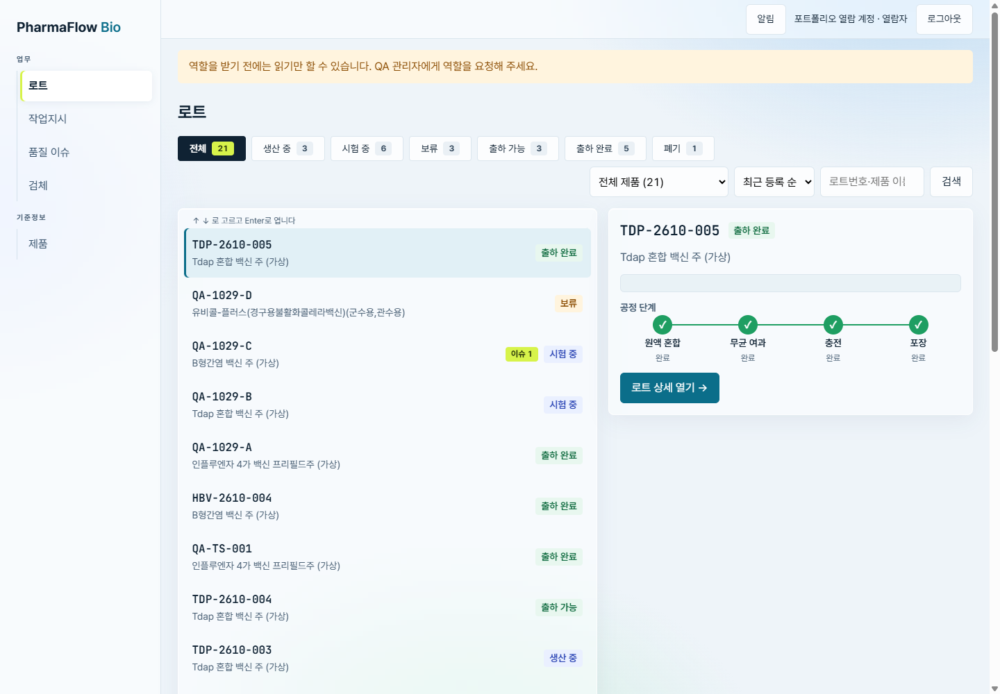
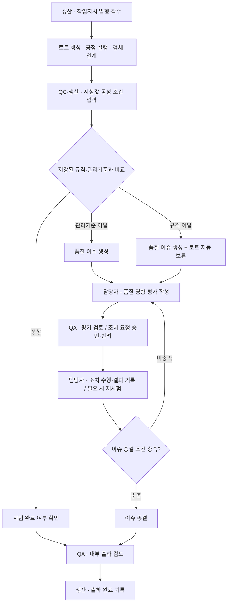
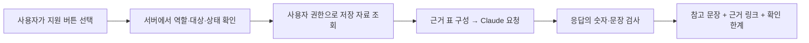
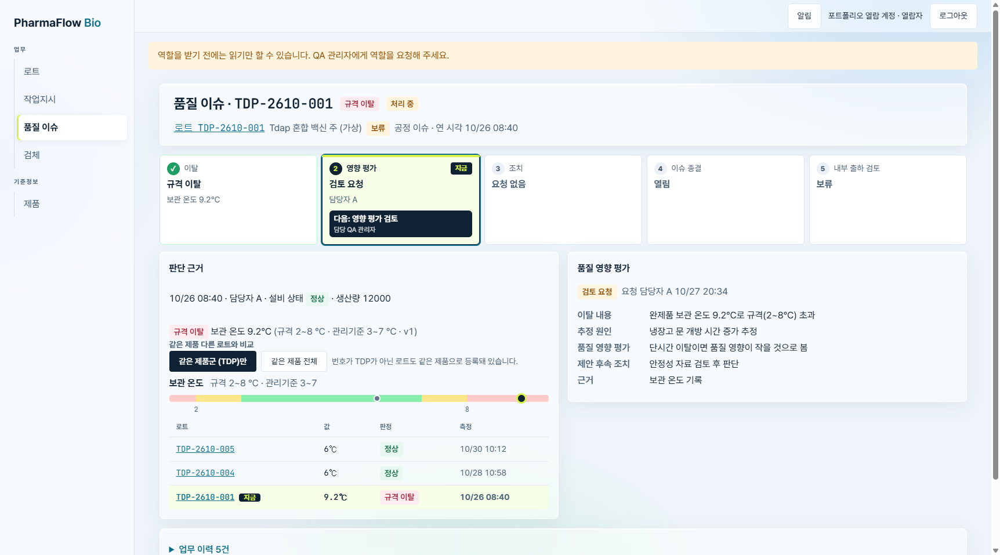
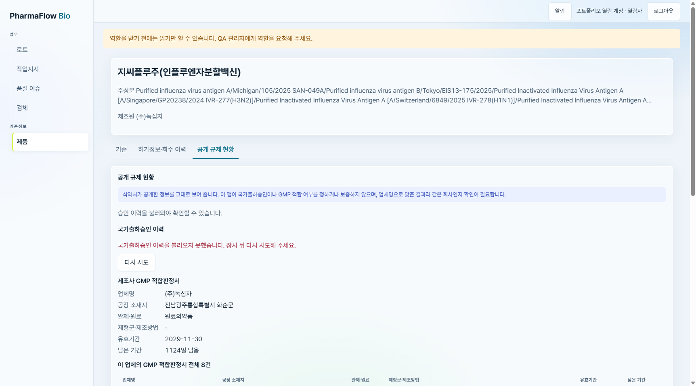
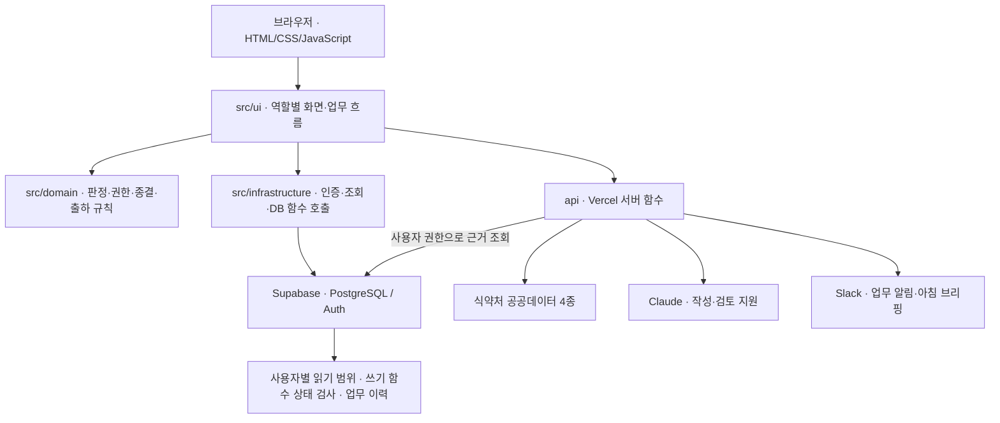

# PharmaFlow Bio

### 흩어진 품질 기록을 로트 하나의 업무 흐름으로

**시험값 입력 → 품질 이탈 확인 → 영향 평가·조치 → 내부 출하 검토**를 연결한 백신 제조 품질관리 웹 앱입니다. QA 관리자(품질 보증), QC 담당자(품질 시험), 생산 담당자가 같은 로트의 진행 상태와 판단 근거를 확인합니다. 로트는 한 번에 생산·관리하는 제품 묶음입니다.

[서비스 열기 (게스트로 둘러보기 가능)](https://pharmaflowbio.vercel.app) · [팀 서비스](https://pharmaflow-iota.vercel.app) · [개인 기여](#3-개인-기여--김희재) · [화면과 기능](#4-화면으로-보는-결과) · [사용 API](#6-사용-api와-외부-연동) · [실행 방법](#8-실행-방법)



*실제 배포 서비스의 열람자 첫 화면입니다. 상태별 목록과 선택한 로트의 공정 진행을 함께 보여 줍니다. 발표 슬라이드를 사용하지 않고 2026-11-02에 새로 캡처했습니다.*

| 프로젝트 | 내용 |
|---|---|
| 형태 | 3인 팀 프로젝트 · 개인 기여 중심 포트폴리오 |
| 핵심 구현 | 역할별 업무 화면, 세 단계 품질 판정, 이슈·평가·조치·출하 검토 연결 |
| 개인 담당 | 공개 규제 현황(021), AI 작성·검토 지원(022~024), 문제 정의·요구사항·데이터 구조 문서 |
| 기술 | JavaScript · Node.js · Supabase(PostgreSQL·Auth) · Vercel |
| 외부 연동 | 식약처 공공데이터 API 4종 · Claude Messages API · Slack Web API |
| 확인 결과 | 현재 사본 자동 시험 **537개 통과 / 실패 0개** (2026-11-05, 함수·모의 응답 시험) |

> **자료의 범위:** 페르소나 인터뷰와 회사·로트·시험값·관리기준은 교육용 가상 자료입니다. 식약처 공개 정보는 실제 자료이며, 가상 로트의 품질을 증명하지 않습니다. 이 앱은 사내 출하 검토를 돕습니다. 국가출하승인을 수행하지 않습니다.

## 1. 문제 정의 — “이 값이 이상한가?”에서 “이 로트는 어디까지 처리됐는가?”로

처음에는 **품질 이탈을 발견하고 전달하는 과정**을 문제 후보로 삼았습니다. 이후 QA 4명·QC 1명으로 구성한 **AI 가상 페르소나 인터뷰**를 통해, 연습 시나리오에서 반복되는 행동을 정리했습니다. 실제 종사자 대상의 사용자 조사 결과는 아닙니다.

| 가상 인터뷰에서 드러난 장면 | 문제 해석 | 제품에 반영한 방식 |
|---|---|---|
| QA가 서명 직전에 시스템·엑셀·폴더를 오가며 열린 이슈를 확인 | 기록은 있어도 로트 단위로 모여 있지 않음 | 로트 상세에 시험·이슈·공정·검체·이력 연결 |
| QA는 QC의 완료 처리를, QC는 QA의 종료 서명을 기다리며 다시 문의 | 현재 단계와 다음 담당자를 알기 어려움 | 이슈의 5단계 진행 표시와 ‘다음에 할 일’ 안내 |
| 공유 대장을 만들었지만 다른 부서가 갱신하지 않아 신뢰를 잃음 | 별도의 현황표를 또 관리하면 같은 문제가 반복될 수 있음 | 시험값·평가·조치의 업무 기록을 기준으로 상태 표시 |
| 점검 때 승인 근거를 메일과 결재함에서 다시 찾음 | 최종 상태만으로 판단 과정을 설명하기 어려움 | 측정 당시 기준·버전과 행위자·시각을 이력에 보존 |

원문에는 “세 시스템은 서로 연동되지 않습니다”, “종료 서명은 QA가 하는 건데, 독촉은 QC로 옵니다”라는 장면이 등장합니다. 이를 바탕으로 과제를 **‘이탈 알림’에서 ‘처리 상태와 승인 근거를 연결하는 업무 흐름’으로 구체화**했습니다.

이탈 전달 누락은 시나리오에서 뒷받침되지 않아 핵심 문제에서 제외했습니다. 인터뷰의 시간·빈도는 가정값이므로 실제 손실이나 개선 성과로 사용하지 않았습니다.

근거: [인터뷰 정리](docs/interview.md) · [페르소나](docs/personas/) · [요구사항 정의](docs/PRD.md) · [사용자 여정](docs/uj.md)

## 2. 해결 방식 — 로트의 시작부터 출하 검토까지



이슈 종류에 따라 조치 필요 여부가 달라지는 대표 흐름입니다. **핵심은 다음 단계로 넘어갈 수 있는 조건입니다.**

| 연결 지점 | 구현한 규칙 |
|---|---|
| 시험값 → 판정 | 정상·관리기준 이탈·규격 이탈로 구분. 규격 이탈일 때만 자동 보류 |
| 평가·조치 → 이슈 종결 | 승인된 평가가 필요하며, 규격 이탈은 완료된 조치도 필요. 진행 중인 조치가 남으면 종결 차단 |
| 이슈 종결 → 출하 검토 | 열린 이슈·미완료 시험 등이 있으면 출하 가능 선택을 막고 이유 표시 |
| 과거 판정 → 현재 조회 | 측정 당시 규격·관리기준·버전을 함께 저장하여 기준 변경 후에도 과거 판단 근거 유지 |

예를 들어 **교육용 보관 온도 규격이 2~8℃인데 9.2℃가 입력되면**, 규격 이탈 이슈가 생성되고 로트가 보류됩니다. 평가 승인만으로 출하 가능으로 바뀌지 않습니다. 조치와 이슈 종결, 시험 완료 여부를 확인한 뒤 QA가 별도로 출하를 검토합니다.

상태 변경은 데이터베이스 함수에서도 검사합니다. 화면에서 버튼을 숨기는 것에만 의존하지 않도록 구성했습니다. [판단 규칙과 한계](docs/03-data-or-automation.md)

## 3. 개인 기여 — 김희재

전체 업무 기능은 팀 결과물입니다. 아래는 기능별 담당 문서와 원본 PR에서 확인되는 **개인 작업 범위**입니다.

### 공개 규제 현황: 조회 결과를 비교 가능한 근거로 만들기

제품 상세에 **GMP 적합판정서·백신 국가출하승인 조회와 비교 화면**을 구현했습니다. GMP는 의약품 제조 및 품질관리기준입니다.

- **허가정보·출하승인·GMP 사이 업체명 대조:** 이름이 비슷한 업체를 같은 회사로 확정하지 않도록 구분합니다.
- **업무 맥락과 비교:** 승인 제조번호와 회수 공지, 작업지시 일정과 GMP 유효기간을 함께 확인하도록 구성했습니다.
- **조회 결과 해석:** 읽음·자료 없음·조회 실패를 구분합니다. 0건을 ‘미승인’이나 ‘부적합’으로 바꾸지 않으며, 조회 범위와 시각을 표시합니다.

구현: [제품 규제 화면](src/ui/pages/product-regulatory.js) · [비교 규칙](src/domain/regulatory-rules.js) · [GMP API](api/gmp.js) · [국가출하승인 API](api/shipment.js)

근거: [원본 PR #24](https://github.com/dbdpfla98/PharmaFlow/pull/24) — 본문에 개인 구현인 phase-13-regulatory-card의 병합이 명시되어 있습니다. PR에는 다른 팀원의 후속 조회 수정도 포함됩니다.

### AI 작성·검토 지원: 답변에 앞서 근거를 읽는 구조

Claude를 활용해 **로트 출하 검토 요약·규제 확인 요청문, 이슈 조사 준비·평가서 보완·조치 이후 확인, 기준 변경 영향·일정 확인**을 지원하는 기능을 구현했습니다(spec 022~024).



화면과 서버가 공통 권한표를 사용하고, 서버가 직접 읽은 자료로 근거 표를 만듭니다. 응답의 숫자 등이 근거와 어긋나면 경고합니다. AI는 문장을 정리하며, **저장·승인·출하 상태 변경은 기존 업무 절차에서 사람이 수행**합니다.

구현: [AI 서버](api/ai.js) · [권한·상태 규칙](src/domain/ai-policy-rules.js) · [서버 근거 조회](api/_ai-data.js) · [이슈 작성·검토 화면](src/ui/pages/issue-ai.js)

근거: [원본 PR #28](https://github.com/dbdpfla98/PharmaFlow/pull/28) — phase-14-ai-briefing의 022~024를 개인 작업으로 구분합니다. 같은 PR의 **챗봇(025)·아침 브리핑(026)은 유○○ 담당**입니다. 홈 ‘오늘 먼저 볼 것’·‘업무 찾아보기’는 최종 화면에서 제외되어 대표 결과에 포함하지 않았습니다.

**검증 범위:** 022~024는 함수 시험과 가짜 AI 응답을 이용한 확인 기록이 있습니다. 실제 Claude 호출 품질은 미확인입니다. 챗봇·아침 브리핑의 실제 호출 기록과 구분합니다. [AI 검증 기록](docs/03-data-or-automation.md)

### 기획과 데이터 구조: 문제에서 구현 근거까지 연결

리서치·인터뷰 결과의 문제 정의, 요구사항, ERD(데이터 관계도)·IA(화면 구성도), 제출 점검표와 데이터 구조 발표 자료를 정리했습니다. 가상 인터뷰의 가정과 구현·검증 결과를 구분하고 관련 문서를 연결했습니다.

근거: [원본 PR #20](https://github.com/dbdpfla98/PharmaFlow/pull/20) · [데이터 관계도](docs/ERD.md) · [화면 구성도](docs/IA.md) · [요구사항 점검표](docs/coverage.md). PR #20은 문서 작업이며, 인터뷰 질문지·페르소나 설계 자료는 윤○○ 담당입니다.

## 4. 화면으로 보는 결과

### ① 로트 현황 — 목록에서 상태를 보고, 상세에서 근거 확인

상단 대표 화면처럼 생산 중·시험 중·보류·출하 가능·출하 완료 등을 나누어 봅니다. 제품 필터·검색·정렬과 선택 항목 미리보기를 제공하며, 상세에서 시험·이슈·공정·검체·이력을 연결합니다. 역할별 홈은 QA의 승인·출하 검토, QC의 시험·검체, 생산의 작업지시·공정 업무를 중심으로 구성했습니다.

### ② 품질 이슈 — 현재 단계와 다음 담당자를 함께 표시



**이탈 → 영향 평가 → 조치 → 이슈 종결 → 내부 출하 검토**를 한 줄로 보여 줍니다. 측정값 옆에 당시 규격·관리기준·버전을 표시하고 같은 제품의 다른 로트와 비교합니다. 이 화면은 ‘규격 이탈로 보류되었고, QA의 영향 평가 검토를 기다리는 상태’를 보여 줍니다.

### ③ 공개 규제 현황 — 출처와 조회 상태까지 표시



국가출하승인 이력·GMP 유효기간·회수 대조·업체명 대조·생산 일정 비교를 한 탭에 모았습니다. 촬영 당시 GMP는 재시도 후 정상 조회됐고, 국가출하승인은 실패·재시도 안내가 표시됐습니다. 자료 없음과 조회 실패도 구분합니다. **현재 무엇을 확인할 수 있는지, 무엇은 확인하지 못했는지를 함께 보여 줍니다.**

검체 전달·인수·반납·소진·폐기, 작업지시·공정 실행, 승인 대기, Slack 알림, 앱 안내·화면 근거 기반 AI 도우미도 제공합니다. [기능별 상세](docs/features/README.md)

*실제 배포 화면을 새로 촬영했으며 업무 자료는 교육용입니다. 계정명과 화면에 노출된 팀원 이름만 비식별 처리했습니다. 열람자 권한으로 촬영해 작성·승인 버튼은 보이지 않습니다. [캡처 방법·확인 상태](docs/images/README.md)*

## 5. 구조 — 화면, 업무 규칙, 데이터 접근을 나누기



| 영역 | 기술과 역할 |
|---|---|
| 화면 | HTML·CSS·JavaScript ES Modules, Pretendard. 별도 UI 프레임워크 없이 구성 |
| 업무 규칙 | src/domain의 판정·권한·이슈·출하 규칙을 데이터 접근과 분리하여 함수 시험 |
| 데이터·인증 | Supabase PostgreSQL·Auth, Google 로그인. RLS(사용자별 읽기 범위 제한), RPC(DB 함수 호출)를 통한 쓰기 |
| 서버 | Node.js 로컬 서버, Vercel 서버 함수. 외부 API 인증키는 서버 환경변수에서 사용 |
| 알림·자동 실행 | Slack 알림·확인 표시, Vercel Cron을 통한 평일 08시 직무별 브리핑 |
| 검증 | Node.js 기본 시험 도구, Supabase SQL 시험 파일, 기능별 QA 문서 |

핵심 관계는 **제품 → 로트 → 측정값·품질 이슈 → 영향 평가·조치**입니다. 작업지시·공정·검체는 같은 로트에 연결하고, 누가 무엇을 했는지는 업무 이력에 남깁니다. [전체 ERD](docs/ERD.md) · [설계 결정 기록](docs/adr/)

## 6. 사용 API와 외부 연동

### 식약처 공공데이터 API 4종

| API · 공식 출처 | 사용하는 정보 | 앱에서의 용도 | 서버 코드 |
|---|---|---|---|
| [의약품 제품 허가정보](https://www.data.go.kr/data/15095677/openapi.do) | 품목명·업체명·주성분·허가일·품목 구분 | 제품 등록 검색, 허가정보 확인 | [permit.js](api/permit.js) |
| [의약품 회수·판매중지 정보](https://www.data.go.kr/data/15059114/openapi.do) | 제조번호·회수 사유·회수명령일 | 회수 이력·홈 공지, 승인 제조번호와 대조 | [recall.js](api/recall.js) |
| [의약품 GMP 적합판정서 발급현황](https://www.data.go.kr/data/15097207/openapi.do) | 업체·제조소·제형군·유효기간 | 제조사 규제 현황, 생산 일정과 유효기간 비교 | [gmp.js](api/gmp.js) |
| [감염병백신 국가출하승인정보](https://www.data.go.kr/data/15084883/openapi.do) | 제품명·제조번호·제조수입업자·결과일·유효기간 | 공개 승인 이력, 회수·업체명 대조 | [shipment.js](api/shipment.js) |

공통으로 **성공·0건·실패를 구분**하고 출처·조회 시각을 표시합니다. 실패 시 이 기기에 마지막 정상 결과가 있으면 과거 조회임을 밝혀 보여 줍니다. 일부 조회는 정해진 범위 안에서 검색하므로 전체 이력의 완전성을 보장하지 않습니다. [출처·항목·조회 범위·검증 기록](docs/data-source.md)

### AI·인증·알림

| 서비스 | 사용 범위 | 구현 근거 |
|---|---|---|
| Anthropic Claude Messages API | 작성·검토 지원, 앱 안내 챗봇, 브리핑 문장 생성. 모델은 AI_MODEL로 설정하며 코드 기본값은 claude-haiku-5-5 | [공통 호출](api/_claude.js) · [작성 지원](api/ai.js) · [챗봇](api/chat.js) · [브리핑](api/briefing.js) |
| Supabase Auth·Data API | Google 계정 로그인, 역할 조회, 업무 데이터 읽기·DB 함수 호출 | [store.js](src/infrastructure/store.js) |
| Slack Web API·상호작용 요청 | 담당자 메시지, 확인 표시, 직무별 아침 브리핑 | [발송](api/_slack.js) · [확인 처리](api/slack-actions.js) |

산업안전보건공단 MSDS는 외부 사이트 링크를 제공합니다. MSDS API 직접 연동으로 소개하지 않습니다.

## 7. 검증과 남은 과제

**사람이 자료를 다시 모아야 했던 흐름을 로트 중심의 화면·상태·판단 근거로 연결했습니다.** 실제 현장의 업무 시간 감소나 출하 품질 향상은 측정하지 않았습니다.

| 확인 항목 | 결과와 범위 |
|---|---|
| 현재 사본 자동 시험 | **537개 통과·실패 0개**. 2026-11-05 실행. 판정·경계값·권한 규칙·모의 API 등 함수 시험 |
| 데이터베이스 규칙 시험 | **16개 파일 453건 통과·실패 0개**. 2026-11-05 포트폴리오 DB에서 실행. 역할 권한·판정·이슈·평가·검체·작업지시·게스트 규칙. 각 파일은 끝에서 모든 변경을 되돌림 |
| 화면 | 2026-11-02 배포 서비스의 열람자 로트 목록·이슈 상세·제품 규제 탭 확인 및 새 캡처 |
| 공공데이터 실제 응답 | 2026-10-29 팀 기록에 4종 응답 확인. 현재 캡처 시점의 상태는 [이미지 안내](docs/images/README.md)에 별도 기록 |
| 개인 담당 AI(022~024) | 구현·함수 시험·가짜 응답 확인. 실제 모델 응답 품질 평가는 미확인 |
| DB·역할별 전체 흐름 | SQL 시험 파일·기존 QA 기록이 있으나 이번 수정에서는 운영 DB 쓰기·승인·출하를 시험하지 않음 |

다음 과제는 실제 종사자를 통한 문제 가설 확인, 역할별 처음부터 끝까지의 업무 시험, 개인 담당 AI의 실제 응답 품질 평가입니다. 기준·시험값은 가상이므로 실제 의약품 품질 판단에 사용할 수 없습니다.

상세: [시험 보고서](docs/04-test-report.md) · [QA 기록](docs/qa.md) · [시험 자료](docs/test-data.md) · [사본 준비 기록](MIGRATION-NOTES.md)

## 8. 실행 방법

Supabase 설정은 예시값입니다. 본인 프로젝트와 키를 준비해야 합니다.

1. Node.js를 준비하고 .env.example을 .env로 복사합니다. 서버 API 키는 필요한 기능에 맞춰 설정합니다.
2. 본인 Supabase 프로젝트에 supabase/migrations/의 SQL을 번호 순서대로 적용합니다. GitHub 로그인을 활성화하고 실행 주소를 허용합니다(원본 팀 프로젝트는 구글 로그인).
3. [src/config.js](src/config.js)에 본인 프로젝트 URL과 공개 연결키를 설정합니다. 관리자 비밀키는 이 파일에 넣지 않습니다.
4. 아래 명령으로 실행한 뒤 [로컬 화면](http://localhost:5173)을 엽니다. 최초 계정은 열람자로 시작하므로 QA 역할 설정도 필요합니다. [로그인·역할 설정](docs/specs/001-로그인-권한-기준이탈판정/plan.md)

```bash
node --env-file-if-exists=.env server.js
```

DB·외부 API 키 없이 함수 시험을 실행할 수 있습니다.

```bash
node --test "tests/*.test.js"
```

AI_MODE=fixtures, PUBLIC_DATA_MODE=fixtures는 가짜 응답을 쓰는 로컬 시험용 설정입니다. 로그인·DB 자체를 대체하지 않으며 실제 API 호출 성공을 뜻하지 않습니다.

<details>
<summary><strong>팀 구성·관련 문서</strong></summary>

| 팀원 | 담당 |
|---|---|
| 유○○ | 로그인·권한·판정·조치·출하·검체·알림·작업지시·공정, AI 도우미(025)·아침 브리핑(026), Supabase·Vercel 운영 |
| 윤○○ | 홈·목록·로트·이슈 UI 개편, 디자인 톤, 인터뷰 설계 자료 |
| 김희재 · [huijae1234](https://github.com/huijae1234) | 공개 규제 현황(021), AI 작성·검토 지원(022~024), 문제 정의·요구사항·ERD·IA·제출 문서 |

팀원 두 명의 이름은 개인정보 보호를 위해 가렸습니다.

팀 프로젝트 원본: [dbdpfla98/PharmaFlow](https://github.com/dbdpfla98/PharmaFlow) · [기능별 담당](docs/features/README.md)

- 기획: [PRD](docs/PRD.md) · [IA](docs/IA.md) · [ERD](docs/ERD.md) · [용어집](GLOSSARY.md)
- 구현·설계: [기능별 명세·계획·QA](docs/specs/) · [설계 결정](docs/adr/) · [디자인](docs/DESIGN.md)
- 발표: [발표 소스](발표/index.html) — 기존 발표용 캡처 일부는 사본에서 제외되어 이미지가 열리지 않을 수 있습니다. 리드미의 새 캡처는 docs/images/에 따로 보관합니다.

</details>
