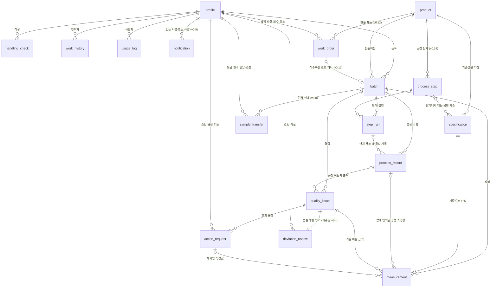
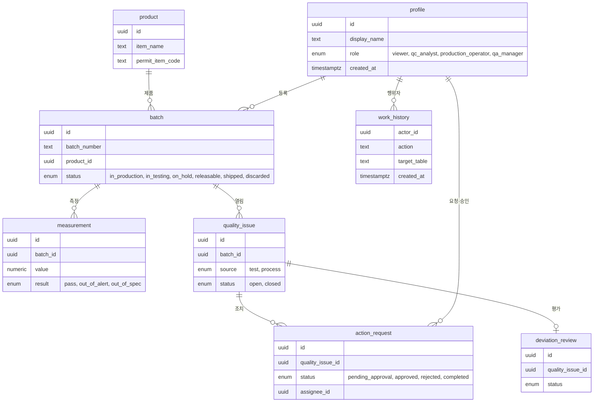
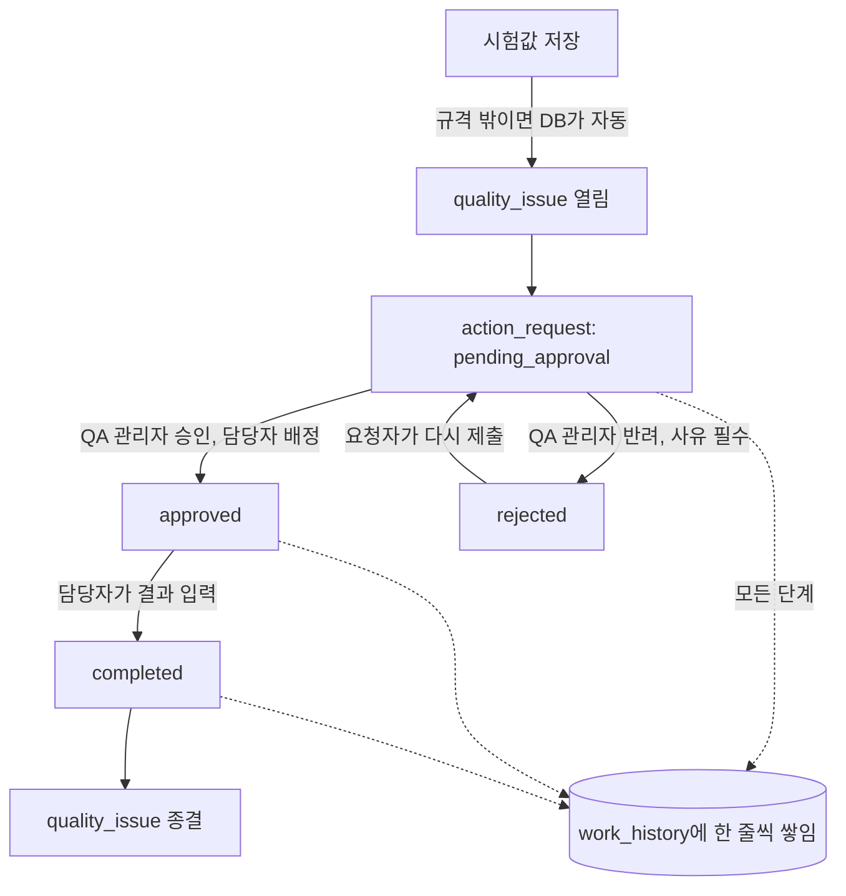

# ERD: PharmaFlow Bio

근거: docs/PRD.md v0.3 (FR-01~39), docs/IA.md v2, docs/문제정의.md v2, GLOSSARY.md(PharmaFlow Bio), docs/adr/0002 (Supabase·구글 로그인·RLS), docs/journeys/ (CUJ-01~03 v2, E1~E8), docs/전환-영향분석-PharmaFlow-Bio.md (D3·D5~D12)
- 최종 갱신: 2026-10-29 (v0.18 알림 종류 morning_briefing, 표 변경 없음, spec 026. v0.17 sample_transfer 폐기 칸·상태 `disposed`·보관 기한 계산·알림 종류 retention_due, spec 018. v0.16 batch 출하 완료 칸·상태 `shipped`·알림 종류 2개, spec 017. v0.15 notification.target_table·target_id, spec 009 v0.7. v0.14 process_step·step_run, spec 011. v0.13 notification.slack_user_id·slack_acknowledged_at, spec 009 v0.6. v0.12 work_order, spec 010. v0.10 notification.read_at, v0.9, spec 009 승인으로 notification 추가. v0.8 sample_transfer, v0.7 승인 2026-10-23)
- 이름 원칙: 표·필드 이름은 그대로 둔다(D3). 화면에서 `batch`는 "로트", `specification`의 범위는 "시험 규격"이라고 부른다. 바뀐 것은 모두 **더하기**이며 기존 자료를 지우거나 바꾸지 않는다(D11).
- 저장소: Supabase(PostgreSQL). 로그인은 Supabase Auth의 구글 로그인이고, `auth.users`는 Supabase가 관리한다.
- 공통: 모든 `id`는 uuid로 자동 생성한다. `*_at`은 시각(timestamptz)이고 기본값은 저장한 시각이다.
- 공공데이터(허가정보, 회수·판매중지, MSDS)는 저장하지 않고 화면을 열 때마다 부른다(PRD 하지 않을 것: 대량 복사). 예외는 제품 등록 때 채운 값과 취급점검 기록에 남기는 물질 식별값뿐이다.

## 관계도

> 선택 기능(FR-39)의 표 4개(`supplier`, `material_lot`, `batch_material`, `supplier_review_request`)는 DB에 만들지 않았다(`supabase/migrations` 확인, 2026-10-28). 설계 설명은 아래에 남기되 그림에서는 뺐다. 실제 DB 표는 17개다.

## 발표용 핵심 표 그림
발표 자료의 "데이터 구조" 장(`발표/erd.html`)과 같은 그림이다. 표 17개 중 요청 흐름에 쓰이는 8개와 대표 칸만 보인다. 칸 이름은 실제 DB와 같다(`supabase/migrations` 대조).

## 가입 흐름과 요청 흐름 그림

## 엔터티

### profile — 사용자
`auth.users`와 1:1. 처음 로그인할 때 열람자로 만들어진다.

| 필드 | 타입 | 필수 | 설명 | 출처 |
|---|---|---|---|---|
| id | uuid | 예 | `auth.users.id`와 같은 값 | [PRD FR-01] |
| display_name | text | 예 | 구글 계정 이름. 업무 이력·담당자 표시에 쓴다 | [PRD FR-16 "누가(이름·역할)"] |
| email | text | 예 | 구글 계정 이메일. QA 관리자만 사용자·역할 화면에서 본다 | [PRD 8절 개인정보], [IA AD_020000_PG] |
| role | enum(`viewer`, `qc_analyst`, `production_operator`, `qa_manager`) | 예 | 역할. 기본값 `viewer`(열람자). QA 관리자만 바꾼다. QA 관리자는 자기 역할을 내릴 수 없다 | [PRD FR-02, FR-03], [GLOSSARY 역할] |
| created_at | timestamptz | 예 | 처음 로그인한 시각. 사용자·역할 화면에서 최근순 정렬 | [PRD FR-03 "새로 로그인한 사람이 맨 위"] |

### product — 제품
| 필드 | 타입 | 필수 | 설명 | 출처 |
|---|---|---|---|---|
| id | uuid | 예 | | |
| item_name | text | 예 | 품목명. 회수·판매중지 정보를 찾는 검색어로도 쓴다 | [PRD FR-06, FR-18, FR-19] |
| main_ingredient | text | 아니오 | 주성분 | [PRD FR-18] |
| manufacturer | text | 아니오 | 제조원 | [PRD FR-18] |
| permit_item_code | text | 아니오 | 허가정보 API의 `ITEM_SEQ`(품목기준코드). 이 품목을 다시 찾는 식별값 (Q3 해결: 2026-10-22 실제 응답으로 확인) | [PRD FR-18, FR-19] |
| created_at | timestamptz | 예 | | |

### specification — 기준 (시험 규격 + 사내 관리기준)
시험 항목과 공정 조건 항목의 기준을 한 표에 둔다. 설비 상태는 숫자 기준이 없으므로 여기에 두지 않는다(process_record 참고). 모든 값은 교육용 가상 값이다(FR-34).

| 필드 | 타입 | 필수 | 설명 | 출처 |
|---|---|---|---|---|
| id | uuid | 예 | | |
| product_id | uuid → product | 예 | | [PRD FR-06] |
| category | enum(`test`, `process`) | 예 | 시험 항목인지 공정 조건 항목인지. 품질 이슈의 발생 구분이 여기서 정해진다 | [PRD FR-06, FR-08, FR-09], [GLOSSARY 품질 이슈] |
| item_name | text | 예 | 항목 이름 (예: 순도, 공정 온도). 같은 제품·구분 안에서 중복 불가 | [PRD FR-06] |
| unit | text | 아니오 | 단위 (예: %, ℃) | [IA BT_010206_MD "기준값이 입력 칸 옆에"] |
| min_value | numeric | 예 | 시험 규격 최솟값. 이 값과 같으면 규격 안 | [PRD FR-08 경계값] |
| max_value | numeric | 예 | 시험 규격 최댓값. 이 값과 같으면 규격 안. `min_value <= max_value`가 아니면 저장하지 않는다 | [PRD FR-06, FR-08] |
| alert_min_value | numeric | 아니오 | (v0.7) 사내 관리기준 최솟값. 비워 두면 관리기준 없음. `min_value <= alert_min_value` | [PRD FR-27], [GLOSSARY 사내 관리기준] |
| alert_max_value | numeric | 아니오 | (v0.7) 사내 관리기준 최댓값. `alert_min_value <= alert_max_value <= max_value`. 둘 다 비우거나 둘 다 채운다 | [PRD FR-27] |
| version | integer | 예 | (v0.7) 기준 버전. 처음 1, 규격이나 관리기준을 고칠 때마다 +1. 기존 행은 1 | [PRD FR-28], [GLOSSARY 기준 버전], [전환 D5] |

### batch — 배치 (화면 이름: 로트)
| 필드 | 타입 | 필수 | 설명 | 출처 |
|---|---|---|---|---|
| id | uuid | 예 | | |
| batch_number | text | 예 | 로트번호 (예: VX-2610-001, 기존 예시 PF-2610-001). 중복 불가 | [PRD FR-07, FR-34], [GLOSSARY 로트] |
| product_id | uuid → product | 예 | | [PRD FR-07] |
| status | enum(`in_production`, `in_testing`, `on_hold`, `releasable`, `discarded`, v0.16: `shipped`) | 예 | 배치 상태: 생산 중, 시험 중, 보류, 출하 가능, 폐기, 출하 완료. 기본값 `in_production`. 바뀌는 규칙은 아래 "배치 상태 규칙" | [문제정의 배치 상태], [PRD FR-08~10, FR-15] |
| hold_reason | text | 아니오 | 직접 보류할 때 적은 사유. 자동 보류면 비어 있고, 이유는 열린 품질 이슈로 보여 준다 | [PRD FR-10] |
| created_by | uuid → profile | 예 | 등록한 사람 | [PRD FR-07, FR-16] |
| created_at | timestamptz | 예 | | |
| shipped_at | timestamptz | `shipped`면 예 | (v0.16) 사람이 넣은 출하 일시. 지금보다 뒤일 수 없고 출하 가능 판정보다 앞설 수 없다 | [spec 017 FR-005] |
| ship_note | text ≤200 | 아니오 | (v0.16) 출하 메모 | [spec 017 FR-005] |
| shipped_by | uuid → profile | `shipped`면 예 | (v0.16) 출하 완료를 기록한 생산 담당자 | [spec 017 FR-005] |
| ship_recorded_at | timestamptz | `shipped`면 예 | (v0.16) 기록한 시각(저장 시각) | [spec 017 FR-005] |

로트 상태 규칙 (2026-10-22 확정, v0.7 고침):
- 생산 중 → 시험 중: 그 로트에 첫 시험값(category `test` 측정값)이 저장되면 자동 (Q1)
- → 보류: **규격 이탈**로 품질 이슈(kind `spec`)가 열리면 자동, 또는 사유를 적어 직접 보류. 관리기준 이탈(kind `alert`)은 보류하지 않는다 (PRD FR-10, FR-29)
- 보류 → 시험 중: 열린 규격 이탈 이슈가 모두 닫히고 직접 보류 사유가 없으면 자동 (Q2)
- 직접 보류(사유 있음)는 QA 관리자가 열린 품질 이슈가 없을 때 내부 출하 검토 모달에서 바로 정한다 (Q2)
- → 출하 가능 / 폐기: QA 관리자의 내부 출하 검토로만. 열린 품질 이슈(종류 상관없이)가 있으면 출하 가능 불가 (PRD FR-15, D6). 영향 평가 승인은 이 조건을 바꾸지 않는다 (FR-33)
- 출하 가능 → 출하 완료 (v0.16): 생산 담당자가 출하 일시를 넣어 기록할 때만. 출하 완료 로트는 시험값·공정 조건·보류·내부 출하 검토로 바꿀 수 없다. 검체 반납은 된다 (spec 017 FR-005·006, Q77). 회사 내부 기록이며 국가출하승인이 아니다
- "로트 폐기"(`batch_discard`) 조치 요청이 완료돼도 로트 상태는 바뀌지 않는다. 폐기 건의 기록일 뿐이다 (Q5)

계산 값 (저장하지 않음):
- 열린 품질 이슈 수: `quality_issue`에서 `status = open`인 개수 [PRD FR-15]
- 내부 출하 검토 대기: `status = in_testing`이고 열린 품질 이슈가 0건 [IA HM_010000_PG]
- 다음에 할 일·단계: 이슈 종류, 영향 평가 상태, 조치 요청 상태, 로트 상태로 계산 [PRD FR-36]

### process_record — 공정 기록
공정 조건 입력 한 번이 한 행이다. 숫자 기준이 있는 항목(예: 공정 온도)은 같은 입력에서 `measurement`로 함께 저장한다.

| 필드 | 타입 | 필수 | 설명 | 출처 |
|---|---|---|---|---|
| id | uuid | 예 | | |
| batch_id | uuid → batch | 예 | | [PRD FR-09] |
| production_quantity | numeric | 아니오 | 생산량. 기준값 없이 기록만 한다 (Q4 확정) | [IA BT_010201_TB "생산량"] |
| equipment_status | enum(`normal`, `abnormal`) | 예 | 설비 상태: 정상, 이상. `abnormal`이면 규격 이탈이다 | [PRD FR-09], [journeys CUJ-02 확정] |
| recorded_by | uuid → profile | 예 | | [PRD FR-16] |
| recorded_at | timestamptz | 예 | | |

### measurement — 측정값
시험값, 공정 조건 값, 재시험 값이 모두 여기에 쌓인다. 저장한 뒤에는 고치지 않는다(업무 이력과 맞추기 위해).

| 필드 | 타입 | 필수 | 설명 | 출처 |
|---|---|---|---|---|
| id | uuid | 예 | | |
| batch_id | uuid → batch | 예 | | [PRD FR-08, FR-09] |
| specification_id | uuid → specification | 예 | 어느 기준값으로 판정했는지 | [PRD FR-08] |
| value | numeric | 예 | 측정값 | [PRD FR-08] |
| result | enum(`pass`, `out_of_alert`, `out_of_spec`) | 예 | 판정: 정상, 관리기준 이탈(v0.7 추가), 규격 이탈. 저장할 때 계산해 함께 저장한다. 규격 밖 → `out_of_spec`, 규격 안이고 관리기준이 있는데 그 밖 → `out_of_alert`, 나머지 → `pass`. 경계값은 범위 안 | [PRD FR-08, FR-27], [GLOSSARY 판정] |
| applied_min_value | numeric | 예 | 판정에 쓴 그때의 최솟값. 기준값이 바뀌어도 측정값 옆에 당시 기준을 보여 주기 위해 (Q16) | [spec 002 FR-014], [Intent Q16] |
| applied_max_value | numeric | 예 | 판정에 쓴 그때의 최댓값 (Q16) | [spec 002 FR-014] |
| applied_alert_min_value | numeric | 아니오 | (v0.7) 판정에 쓴 그때의 관리기준 최솟값. 관리기준이 없었으면 비어 있음 | [PRD FR-28] |
| applied_alert_max_value | numeric | 아니오 | (v0.7) 판정에 쓴 그때의 관리기준 최댓값 | [PRD FR-28] |
| applied_spec_version | integer | 예 | (v0.7) 판정에 쓴 그때의 기준 버전. 기존 행은 1 | [PRD FR-28], [전환 D5] |
| process_record_id | uuid → process_record | 아니오 | 공정 조건 입력으로 생긴 측정값이면 그 공정 기록 | [PRD FR-09] |
| quality_issue_id | uuid → quality_issue | 아니오 | 이 측정값 때문에 열렸거나, 재시험으로 붙은 품질 이슈 | [PRD FR-08, FR-09, FR-14] |
| action_request_id | uuid → action_request | 아니오 | 재시험 조치 결과로 입력한 측정값이면 그 조치 요청 | [PRD FR-14] |
| measured_by | uuid → profile | 예 | | [PRD FR-16] |
| measured_at | timestamptz | 예 | | |

### quality_issue — 품질 이슈
| 필드 | 타입 | 필수 | 설명 | 출처 |
|---|---|---|---|---|
| id | uuid | 예 | | |
| batch_id | uuid → batch | 예 | | [PRD FR-08, FR-09, FR-11] |
| source | enum(`test`, `process`) | 예 | 발생 구분: 시험, 공정 | [PRD FR-11], [GLOSSARY 품질 이슈] |
| kind | enum(`spec`, `alert`) | 예 | (v0.7) 종류: 규격 이탈, 관리기준 이탈. 기본값 `spec`(기존 이슈는 모두 `spec`). 같은 입력에 둘이 섞이면 `spec`. 재시험 결과가 규격 이탈이면 `alert` → `spec`으로 올린다 | [PRD FR-29], [GLOSSARY 품질 이슈] |
| process_record_id | uuid → process_record | 아니오 | 공정 이탈로 열린 이슈면 그 공정 기록. 시험 이탈이면 비어 있음. 설비 상태만 "이상"이어서 연결된 측정값이 없어도 출처를 찾기 위해 둔다 (Q15) | [PRD FR-09], [spec 001 FR-011], [Intent Q15] |
| status | enum(`open`, `closed`) | 예 | 기본값 `open`. 닫기 조건은 아래 | [PRD FR-14, FR-15, FR-32] |
| opened_at | timestamptz | 예 | | [PRD FR-11] |
| closed_by | uuid → profile | 아니오 | | [PRD FR-14, FR-16] |
| closed_at | timestamptz | 아니오 | | [PRD FR-14] |

기준 이탈 내용(어느 항목이 얼마였는지, 적용 기준과 버전)은 따로 저장하지 않고 연결된 `measurement`로 보여 준다. 공정 이탈에서 설비 상태 "이상"은 `process_record_id`의 공정 기록으로 보여 준다.

닫기 조건 (v0.7, D8): 열린 조치 요청(승인 대기·승인됨)이 없고, 승인된 품질 영향 평가가 있어야 한다. `spec`이면 완료된 조치 요청도 1건 이상 있어야 한다. 닫는 사람은 그 이슈의 조치 요청에 배정됐던 사람 또는 QA 관리자 (Q19).

### action_request — 조치 요청
| 필드 | 타입 | 필수 | 설명 | 출처 |
|---|---|---|---|---|
| id | uuid | 예 | | |
| quality_issue_id | uuid → quality_issue | 예 | | [PRD FR-12] |
| action_type | enum(`retest`, `equipment_check`, `material_check`, `batch_discard`) | 예 | 조치 종류: 재시험, 설비 점검, 원료 확인, 로트 폐기(값 이름은 그대로). 로트 폐기는 폐기 건의이며 로트 상태를 바꾸지 않는다 (Q5) | [PRD FR-12] |
| description | text | 아니오 | 요청 내용 | [PRD FR-12] |
| status | enum(`pending_approval`, `approved`, `rejected`, `completed`) | 예 | 승인 대기, 승인됨, 반려됨, 완료. 재제출하면 `rejected` → `pending_approval`. 승인·반려는 `pending_approval`일 때만 바뀐다(동시 처리 막기) | [PRD FR-12, FR-13, FR-14, FR-25] |
| requested_by | uuid → profile | 예 | 요청자 | [PRD FR-13 "요청자가 고쳐 다시 제출"] |
| requested_at | timestamptz | 예 | 마지막으로 제출한 시각 | [PRD FR-13] |
| assignee_id | uuid → profile | 아니오 | 배정된 담당자. 승인할 때 필수 | [PRD FR-13] |
| reviewed_by | uuid → profile | 아니오 | 승인·반려한 QA 관리자 | [PRD FR-13] |
| reviewed_at | timestamptz | 아니오 | | [PRD FR-13] |
| rejection_reason | text | 아니오 | 반려 사유. 반려할 때 필수 | [PRD FR-13] |
| result_note | text | 아니오 | 조치 결과 내용 | [PRD FR-14], [GLOSSARY 조치 결과] |
| completed_at | timestamptz | 아니오 | | [PRD FR-14] |

반려·재제출을 여러 번 해도 이 행 하나를 고친다. 지난 반려 사유와 제출 내용은 `work_history`에 남는다.

### deviation_review — 품질 영향 평가 (v0.7)
품질 이슈 하나에 하나(D7). 보완 요청·반려 뒤 다시 제출해도 이 행 하나를 고치고, 지난 내용은 `work_history`에 남는다. 로트·발생 일시·시험 항목·측정값·적용 기준과 버전은 저장하지 않고 이슈와 측정값에서 읽는다(중복 저장 방지). 처리 결과는 조치 결과(`action_request.result_note`)와 이슈 종료로 보여 준다.

| 필드 | 타입 | 필수 | 설명 | 출처 |
|---|---|---|---|---|
| id | uuid | 예 | | |
| quality_issue_id | uuid → quality_issue | 예 | 유일 (이슈당 하나) | [PRD FR-30], [전환 D7] |
| status | enum(`submitted`, `approved`, `rejected`, `revision_requested`) | 예 | 검토 요청, 승인, 반려, 보완 요청. 반려·보완 요청 → (요청자가 고쳐 다시 제출) → `submitted`. 승인은 최종이며 다시 바꾸지 않는다. 승인·반려·보완 요청은 `submitted`일 때만 바뀐다(동시 처리 막기) | [PRD FR-30, FR-31], [GLOSSARY 품질 영향 평가·보완 요청] |
| deviation_summary | text | 예 | 이탈 내용 | [PRD FR-30] |
| probable_cause | text | 예 | 추정 원인 | [PRD FR-30] |
| impact_assessment | text | 예 | 품질 영향 평가 | [PRD FR-30] |
| proposed_action | text | 예 | 제안 후속 조치 | [PRD FR-30] |
| evidence | text | 아니오 | 관련 근거 (문서 번호·자료 설명. 파일 첨부 없음) | [PRD FR-30] |
| requested_by | uuid → profile | 예 | 요청자 (작성한 사람) | [PRD FR-30] |
| requested_at | timestamptz | 예 | 마지막으로 제출한 시각 | [PRD FR-30] |
| reviewed_by | uuid → profile | 아니오 | 검토한 QA 관리자 | [PRD FR-31] |
| reviewed_at | timestamptz | 아니오 | | [PRD FR-31] |
| review_comment | text | 아니오 | 승인·반려·보완 요청 사유. 반려·보완 요청이면 필수 | [PRD FR-31] |

### supplier — 공급사 (v0.7, 선택 FR-39, DB에 없음)
| 필드 | 타입 | 필수 | 설명 | 출처 |
|---|---|---|---|---|
| id | uuid | 예 | | |
| name | text | 예 | 공급사 이름(교육용 가상). 중복 불가 | [PRD FR-39], [GLOSSARY 공급사] |
| created_at | timestamptz | 예 | | |

### material_lot — 원료 로트 (v0.7, 선택 FR-39, DB에 없음)
| 필드 | 타입 | 필수 | 설명 | 출처 |
|---|---|---|---|---|
| id | uuid | 예 | | |
| supplier_id | uuid → supplier | 예 | | [PRD FR-39] |
| material_name | text | 예 | 원료명 (예: 항원 원액, 면역증강제 — 교육용 가상) | [PRD FR-39] |
| lot_number | text | 예 | 원료 로트번호. 같은 공급사 안에서 중복 불가 | [PRD FR-39] |
| received_at | date | 예 | 입고일. 반복 이탈 기간 계산에 쓴다 | [PRD FR-39] |
| inspection_item | text | 아니오 | 입고 검사 항목 (시험 항목별 반복 이탈 집계) | [PRD FR-39] |
| inspection_result | enum(`pass`, `out_of_spec`) | 예 | 입고 검사 결과: 적합, 이탈 | [PRD FR-39] |
| recorded_by | uuid → profile | 예 | | [PRD FR-16] |
| created_at | timestamptz | 예 | | |

### batch_material — 로트에 쓰인 원료 로트 (v0.7, 선택 FR-39, DB에 없음)
| 필드 | 타입 | 필수 | 설명 | 출처 |
|---|---|---|---|---|
| batch_id | uuid → batch | 예 | (batch_id, material_lot_id) 유일 | [PRD FR-39] |
| material_lot_id | uuid → material_lot | 예 | | [PRD FR-39] |

### supplier_review_request — 공급사 품질 검토 요청 (v0.7, 선택 FR-39, DB에 없음)
교육용 가상 규칙(D12)을 넘으면 만든다. 공급사를 부적격으로 정하지 않는다.

| 필드 | 타입 | 필수 | 설명 | 출처 |
|---|---|---|---|---|
| id | uuid | 예 | | |
| supplier_id | uuid → supplier | 예 | | [PRD FR-39] |
| material_name | text | 예 | | [PRD FR-39] |
| period_start | date | 예 | 집계 기간 시작 (감지일 − 90일) | [PRD FR-39], [전환 D12] |
| period_end | date | 예 | 집계 기간 끝 (감지일) | [PRD FR-39] |
| inspected_count | integer | 예 | 기간 안 검사 로트 수 | [PRD FR-39] |
| deviation_count | integer | 예 | 기간 안 이탈 수 | [PRD FR-39] |
| status | enum(`open`, `closed`) | 예 | 열림, 닫힘. 같은 공급사·원료에 `open`인 요청이 있으면 새로 만들지 않는다(중복 방지, Q29) | [PRD FR-39] |
| created_by | uuid → profile | 예 | | [PRD FR-16] |
| created_at | timestamptz | 예 | | |

계산 값 (저장하지 않음): 공급사·원료별 검사 로트 수·이탈 수·이탈률, 시험 항목별 반복 이탈, "표본 부족"(검사 로트 5개 미만) [PRD FR-39]

### sample_transfer — 검체 인계 기록 (v0.8, spec 008)
한 번 넘긴 검체 묶음 하나. 길은 생산 → QC(시험 검체), 생산 → QA(보존 검체), QA → QC(보존 검체) 세 가지뿐이다. 상태는 인수 대기 → 보관 중 → 반납 대기 → 반납 완료, 또는 보관 중 → 소진(QC가 받은 것만), 또는 보관 중 → 폐기(생산 → QA 보존 검체, 보관 기한이 지난 뒤 QA 관리자, v0.17). 고치거나 취소하지 않는다(spec 008 Q48). 로트 상태·출하와 연결하지 않는다.

| 필드 | 타입 | 필수 | 설명 | 출처 |
|---|---|---|---|---|
| id | uuid | 예 | | |
| batch_id | uuid → batch | 예 | 어느 로트의 검체인가 | [spec 008 FR-001] |
| sample_kind | enum(`test` 시험 검체, `retention` 보존 검체) | 예 | | [spec 008 FR-001] |
| from_team, to_team | enum(`production`, `qc`, `qa`) | 예 | 보낸 팀·받는 팀. 역할 → 팀: 생산 담당자 → production, QC 시험 담당자 → qc, QA 관리자 → qa | [spec 008 FR-001 수용 기준 2·3] |
| quantity | integer 1~9999 | 예 | 넘긴 수량 | [spec 008 경계 상황] |
| unit | text (바이알·mL·g·개) | 예 | | [spec 008 Q46] |
| note | text ≤200 | 아니오 | 메모 | [spec 008 FR-001] |
| status | enum(`pending` 인수 대기, `held` 보관 중, `return_pending` 반납 대기, `returned` 반납 완료, `consumed` 소진, v0.17: `disposed` 폐기) | 예 | | [spec 008 FR-002~004], [spec 018 FR-004] |
| sent_by, sent_at | uuid → profile, timestamptz | 예 | 보낸 사람·일시 (함수가 넣음) | [spec 008 FR-001] |
| received_by, received_at, storage_location | uuid → profile, timestamptz, text 1~60 | 인수 뒤 | 인수자·인수 일시·보관 위치 | [spec 008 FR-002] |
| returned_quantity, return_requested_by, return_requested_at | integer(1~quantity), uuid → profile, timestamptz | 반납 뒤 | 반납 수량·반납자·반납 등록 일시 | [spec 008 FR-003] |
| return_confirmed_by, returned_at | uuid → profile, timestamptz | 반납 확인 뒤 | 반납 확인자·반납 일시 | [spec 008 FR-003] |
| consumed_by, consumed_at | uuid → profile, timestamptz | 소진 뒤 | | [spec 008 FR-004] |
| disposed_by, disposed_at, disposed_quantity, dispose_note | uuid → profile, timestamptz, integer(0~quantity), text ≤200 | 폐기 뒤(메모 빼고) | (v0.17) 폐기한 QA 관리자·사람이 넣은 폐기 일시·폐기 수량(기록 수량과 그때 QA 보관 수 중 작은 값)·메모. 폐기는 생산 → QA 보존 검체만 | [spec 018 FR-004, Q82] |

- **계산 값** QA 보관 중 보존 검체 수(로트마다): 생산 → QA `held` 수량 − QA → QC 수량(모든 상태) + QA → QC `returned`의 반납 수량 (+ v0.17: 생산 → QA `disposed`의 수량 − 폐기 수량). 저장하지 않는다 [spec 008 Q47], [spec 018 Q82]
- **계산 값** 보관 기한(v0.17): 생산 → QA 보존 검체의 received_at 한국 날짜 + 2년(2월 29일은 2월 28일). 저장하지 않는다. 보관 중이고 오늘(한국)이 기한과 같거나 뒤면 "기한 지남" [spec 018 FR-002, Q80]

### notification — 슬랙 알림 (v0.9, spec 009)
업무가 저장될 때 데이터베이스 트리거가 받는 사람마다 한 줄을 "대기"로 만들고, Vercel 함수가 슬랙으로 보낸 뒤 결과를 적는다(ADR 0003). 업무 자료와 연결하지 않고 로트는 번호 글자로만 남긴다.

| 필드 | 타입 | 필수 | 설명 | 출처 |
|---|---|---|---|---|
| id | uuid | 예 | | |
| recipient_id | uuid → profile | 예 | 받는 사람 (그 일을 한 본인은 빠짐) | [spec 009 FR-001] |
| kind | text (sample_sent, sample_returned, approval_waiting, action_assigned, returned_back, out_of_spec, v0.11: issue_opened, review_approved, action_completed, issue_closed, release_decided, lot_held, sample_received, sample_return_confirmed, v0.16: tests_completed, lot_shipped, v0.17: retention_due, v0.18: morning_briefing — spec 026 아침 브리핑 발송 알림, 상태는 sent·failed로만 넣음) | 예 | 일 종류 | [spec 009 FR-001 표 v0.5] |
| batch_number | text | 아니오 | 로트번호 글자 | [spec 009 FR-001 수용 기준 4] |
| link_path | text (`#/…`) | 예 | 앱 화면 링크 | [spec 009 FR-001 수용 기준 4] |
| message | text ≤500 | 예 | 보낼 글 (사람 입력은 100자, 슬랙 기호는 글자로) | [spec 009 FR-001] |
| created_by, created_at | uuid → profile, timestamptz | 예 | 그 일을 한 사람·시각 | [spec 009 FR-005] |
| status | enum(`pending` 대기, `sending` 보내는 중, `sent` 보냄, `sent_channel` 채널로 보냄, `failed` 보내지 못함) | 예 | | [spec 009 FR-002~004] |
| reason, sent_at | text ≤200, timestamptz | 아니오 | 보내지 못한 이유·보낸 시각 | [spec 009 FR-004, FR-005] |
| read_at | timestamptz | 아니오 | 받는 사람이 앱 알림 함에서 읽은 시각 (v0.10) | [spec 009 FR-007] |
| slack_user_id | text ≤40 | 아니오 | 개인 메시지를 받은 슬랙 사용자. 보낼 때 적고, 채널로 보낸 알림은 비움 (v0.13) | [spec 009 FR-008] |
| target_table, target_id | text, uuid | 아니오 | 어느 기록에서 나온 알림인지(예: sample_transfer, action_request, deviation_review, work_order, quality_issue, measurement, batch). 화면의 그 줄 옆에 슬랙 확인을 보인다. v0.15 전 알림은 비어 있음 (v0.15) | [spec 009 FR-009, Q73] |
| slack_acknowledged_at | timestamptz | 아니오 | 받는 사람이 슬랙 [확인]을 처음 누른 시각. 이때 read_at이 비어 있으면 같은 시각으로 채움. 업무 처리가 아님 (v0.13) | [spec 009 FR-008, Q65] |

### handling_check — 취급점검 기록
| 필드 | 타입 | 필수 | 설명 | 출처 |
|---|---|---|---|---|
| id | uuid | 예 | | |
| chem_id | text | 예 | MSDS 물질 검색 결과의 물질 식별값. 물질 상세 주소에 쓴다 | [IA MS_010100_PG `#/msds/:chemId`] |
| chem_name | text | 예 | 물질 이름 (작성 당시 값) | [PRD FR-21, FR-22] |
| cas_no | text | 아니오 | CAS 번호 | [PRD FR-21] |
| check_content | text | 예 | 점검 내용 | [PRD FR-22] |
| protective_measures | text | 예 | 보호조치 | [PRD FR-22] |
| checked_by | uuid → profile | 예 | | [PRD FR-22] |
| checked_at | timestamptz | 예 | | |

### work_history — 업무 이력
고치거나 지울 수 없다(데이터베이스 규칙으로 막음). 다른 표가 바뀔 때 데이터베이스가 자동으로 한 행씩 남긴다.

| 필드 | 타입 | 필수 | 설명 | 출처 |
|---|---|---|---|---|
| id | uuid | 예 | | |
| actor_id | uuid → profile | 예 | 누가 | [PRD FR-16] |
| actor_name | text | 예 | 그때의 이름 (나중에 이름이 바뀌어도 남도록) | [PRD FR-16 "이름·역할"] |
| actor_role | text | 예 | 그때의 역할 | [PRD FR-16] |
| action | text | 예 | 무엇을 (예: 측정값 입력, 품질 이슈 생성, 배치 보류, 조치 요청 승인, 반려, 재제출, 출하 판정, 역할 지정, 예시 자료 되돌리기, (v0.7) 품질 영향 평가 검토 요청·승인·반려·보완 요청·다시 제출, 기준 수정, 원료 로트 입고, 공급사 검토 요청) | [PRD FR-13, FR-15, FR-16, FR-24, FR-30, FR-31] |
| target_table | text | 예 | 바뀐 표 이름 | [PRD FR-16 "대상"] |
| target_id | uuid | 예 | 바뀐 행 | [PRD FR-16] |
| batch_id | uuid → batch | 아니오 | 관련 배치. 배치 상세의 업무 이력 탭과 배치로 거르기에 쓴다 | [IA BT_010204_TB, AD_030000_PG] |
| batch_number | text | 아니오 | 관련 배치의 배치번호(그때 값). 예시 자료 되돌리기로 배치가 지워져 batch_id를 비운 뒤에도 어느 배치였는지 남긴다 | [spec 003 Q27] [PRD FR-16, FR-24] |
| before_data | jsonb | 아니오 | 바뀌기 전 | [PRD FR-16 "바뀌기 전·후"] |
| after_data | jsonb | 아니오 | 바뀐 뒤 | [PRD FR-16] |
| created_at | timestamptz | 예 | 언제 | [PRD FR-16] |

### usage_log — 사용 기록
QA 관리자만 읽는다. 이메일은 남기지 않는다.

| 필드 | 타입 | 필수 | 설명 | 출처 |
|---|---|---|---|---|
| id | uuid | 예 | | |
| user_id | uuid → profile | 예 | 사용자 ID만 | [PRD FR-23] |
| event_type | enum(`login`, `logout`, `page_view`, `search`, `public_api_call`) | 예 | | [PRD FR-23] |
| path | text | 아니오 | 화면 주소 (`page_view`) | [PRD FR-23] |
| search_term | text | 아니오 | 검색어 (`search`) | [PRD FR-23] |
| api_name | text | 아니오 | 부른 공공데이터 (허가정보·회수·MSDS) | [PRD FR-23] |
| success | boolean | 아니오 | 공공데이터 호출 성공 여부 | [PRD FR-20, FR-23] |
| duration_ms | integer | 아니오 | 공공데이터 호출에 걸린 시간 | [PRD FR-23] |
| created_at | timestamptz | 예 | | |

### work_order — 작업지시 (v0.12, spec 010)
무엇을 얼마나 언제 만들라는 지시 하나. 상태는 작성 → 발행(QA 관리자) → 진행 중(착수 때 로트를 만들어 연결), 착수 전에는 취소. 완료는 기능 011에서 마지막 공정 단계가 끝날 때 쓴다. 작업지시 하나에 로트 하나(MES 설계 Q54). 고치거나 지우지 않는다(spec 010 Q60).

| 필드 | 타입 | 필수 | 설명 | 출처 |
|---|---|---|---|---|
| id | uuid | 예 | | |
| order_number | text, 유일 | 예 | `WO-` + 계획 시작일 연월(YYMM) + `-` + 세 자리 순번. 함수가 매김 | [spec 010 FR-001, Q61] |
| product_id | uuid → product | 예 | | [spec 010 FR-001] |
| planned_quantity | numeric 0 초과 ~ 1,000,000 | 예 | 계획 수량 (소수 허용) | [spec 010 경계 상황] |
| unit | text (바이알·mL·L·개) | 예 | | [spec 010 Q62] |
| planned_start, planned_end | date, 시작 ≤ 끝 | 예 | 계획 기간 | [spec 010 FR-001] |
| note | text ≤200 | 아니오 | 메모 | [spec 010 FR-001] |
| status | enum(`draft` 작성, `released` 발행, `in_progress` 진행 중, `completed` 완료, `cancelled` 취소) | 예 | 진행 중·완료는 batch_id 필수, 취소는 cancel_reason 필수 | [spec 010 FR-002~004] |
| batch_id | uuid → batch, 유일 | 착수 뒤 | 착수 때 만든 로트 | [spec 010 FR-003] |
| created_by·created_at, released_by·released_at, started_by·started_at, cancelled_by·cancelled_at | uuid → profile, timestamptz | 단계마다 | 함수가 넣음 | [spec 010 FR-001~004] |
| cancel_reason | text 1~200 | 취소 때 | | [spec 010 FR-004] |

### process_step — 제품별 공정 단계 (v0.14, spec 011)
제품의 생산 순서 한 칸. 실행 기록이 있는 단계는 이름을 바꾸지 않고, 실행 기록이 있는 제품은 순서를 바꾸지 않는다. 지우지 않고 "쓰지 않음"으로 표시한다.

| 필드 | 타입 | 필수 | 설명 | 출처 |
|---|---|---|---|---|
| id | uuid | 예 | | |
| product_id | uuid → product | 예 | | [spec 011 FR-001] |
| step_order | integer 1~20, (product_id, step_order) 유일 | 예 | 순서 | [spec 011 FR-001] |
| name | text 1~40, (product_id, name) 유일 | 예 | 예: 세포 배양, 정제, 원액 여과, 충전, 포장 (교육용 가상) | [spec 011 FR-001] |
| retired_at | timestamptz | 아니오 | 쓰지 않음 표시 시각. 새 로트에서 건너뛰고 번호에서 빠짐 | [spec 011 경계 상황] |
| created_by, created_at | | 예 | | |

### step_run — 로트별 단계 실행 (v0.14, spec 011)
한 로트에서 한 단계를 착수·완료한 기록. "대기"는 줄이 없는 상태로 계산한다. 한 로트에 진행 중 단계는 하나뿐이다.

| 필드 | 타입 | 필수 | 설명 | 출처 |
|---|---|---|---|---|
| id | uuid | 예 | | |
| batch_id, process_step_id | uuid | 예 | (batch_id, process_step_id) 유일 | [spec 011 FR-004] |
| status | enum(`in_progress` 진행 중, `completed` 완료) | 예 | | [spec 011 FR-003] |
| step_label | text | 예 | 착수 당시 "3/5 원액 여과" (이력·화면용, 단계 정의가 바뀌어도 그대로) | [spec 011 FR-009] |
| line_clearance | text[] 4개 | 예 | 확인한 라인 클리어런스 항목. 확인자·시각은 착수자·착수 시각 | [spec 011 FR-004, Q69] |
| started_by·started_at, completed_by·completed_at | uuid → profile, timestamptz | 단계마다 | 착수한 사람과 완료한 사람은 다를 수 있음(Q72) | [spec 011 FR-004·005] |

더한 칸 (빈 값 허용): `process_record.step_run_id`(단계 완료 때 공정 기록), `specification.process_step_id`(공정 기준을 재는 단계, 비면 마지막 단계에서 받음 Q71), `work_order.completed_by·completed_at`(마지막 단계 완료 때) [spec 011 FR-002·005·006]

## 권한 요약 (RLS)
IA "역할별로 쓸 수 있는 화면" 표를 데이터베이스 규칙으로 옮긴 것이다. 상세 SQL은 plan에서 쓴다.

| 표 | 읽기 | 쓰기 |
|---|---|---|
| profile | 로그인한 사람: 이름·역할. email은 QA 관리자만 | 역할: QA 관리자만 (자기 역할 내리기 불가) |
| product, specification | 로그인한 사람 | QA 관리자 (되돌리기 때 함수가 지우고 다시 넣음) |
| batch | 로그인한 사람 | 등록: 작업지시 착수(생산 담당자·QA 관리자) 또는 QA 관리자 직접 등록(예외, spec 010 FR-007) / 보류: 생산 담당자, QA 관리자 / 출하 판정: QA 관리자 |
| process_record, 공정 measurement | 로그인한 사람 | 생산 담당자, QA 관리자 |
| 시험 measurement | 로그인한 사람 | QC 시험 담당자, QA 관리자 / 재시험: 배정된 담당자 |
| quality_issue | 로그인한 사람 | 자동 생성(데이터베이스) / 닫기: 배정됐던 담당자, QA 관리자 (닫기 조건 v0.7) |
| deviation_review (v0.7) | 로그인한 사람 | 작성·다시 제출: QC·생산 담당자, QA 관리자 (다시 제출은 요청자 본인) / 승인·반려·보완 요청: QA 관리자 |
| action_request | 로그인한 사람 | 등록·재제출: QC·생산 담당자, QA 관리자 / 승인·반려: QA 관리자 / 결과: 배정된 담당자 |
| handling_check | 로그인한 사람 | 열람자 빼고 모두 |
| supplier, supplier_review_request (v0.7 선택) | 로그인한 사람 | 공급사 등록: QA 관리자 / 검토 요청: 데이터베이스 함수(감지 조건) |
| material_lot, batch_material (v0.7 선택) | 로그인한 사람 | QC 시험 담당자, QA 관리자 |
| work_history | 로트 관련(batch_id 있음): 로그인한 사람 / 전체: QA 관리자 | 데이터베이스 자동 기록만. 고치기·지우기 불가 (되돌리기 때 batch_id만 비움 → 그 줄은 QA 관리자만 읽음) |
| usage_log | QA 관리자 | 본인 기록 추가만 |
| notification (v0.9) | QA 관리자 전체, 받는 사람은 자기 것(v0.10), 알림을 일으킨 사람은 자기가 일으킨 것(v0.15) | 트리거가 만들고, 보내기 결과는 함수로만(만든 사람 본인의 알림만 가져가고 결과를 적음). 슬랙 [확인] 기록은 `acknowledge_notification` 하나로, Vercel 함수(service_role)만 (v0.13) |
| process_step, step_run (v0.14) | 로그인한 사람 | 함수로만. 단계 정의·기준 잇기: QA 관리자 / 착수·완료: 생산 담당자, QA 관리자 (작업지시 로트, 생산 중일 때만) |
| work_order (v0.12) | 로그인한 사람 | 함수로만. 작성·착수·취소(착수 전): 생산 담당자, QA 관리자 / 발행: QA 관리자 |
| sample_transfer (v0.8) | 로그인한 사람 | 함수로만. 전달: 생산 담당자(생산 → QC·QA), QA 관리자(QA → QC, 보관 수 안에서) / 인수 확인·반납: 받는 팀 / 반납 확인: 보낸 팀 / 소진: QC가 받은 것을 QC 시험 담당자 |

## 확인 필요
| # | 질문 | 막고 있는 필드 | 가정 | 출처 |
|---|---|---|---|---|
| — | 없음 | | | |

이전 질문:
- Q28 해결(2026-10-23): 규격 이탈 이슈의 재시험이 관리기준 이탈이면 종류는 `spec` 그대로 두고 조치 완료로 본다.
- Q29 해결(2026-10-23): 같은 공급사·원료에 열린 공급사 검토 요청이 있으면 새로 만들지 않는다.
- Q1, Q2, Q4, Q5는 2026-10-22 사용자가 추천대로 확정했고 (batch "배치 상태 규칙", process_record, action_request에 반영), Q3은 같은 날 허가정보 API 실제 응답에서 `ITEM_SEQ`로 확인했다.

## 변경 기록
| 날짜 | 버전 | 바뀐 내용 |
|---|---|---|
| 2026-10-22 | v0.1 | 처음 작성. 엔터티 11개, 확인 필요 Q1~Q5 |
| 2026-10-22 | v0.2 | Q1·Q2·Q4·Q5 확정 반영 (배치 상태 규칙). Q3만 남음 |
| 2026-10-29 | v0.18 | spec 026: notification.kind에 `morning_briefing` (마이그레이션 0036). 새 표·칸 없음. 읽기 전용 함수 morning_briefing_items 등은 service_role만 |
| 2026-10-28 | v0.18 | 발표용 핵심 표 그림(표 8개, 대표 칸), 가입 흐름·요청 흐름 그림 추가. 선택 기능 표 4개는 DB에 없어 관계도에서 빼고 "DB에 없음" 표시. 구조 변경 없음(문서만) |
| 2026-10-28 | v0.17 | spec 018: sample_transfer.status에 `disposed`(폐기), disposed_by·disposed_at·disposed_quantity·dispose_note, 계산 값 보관 기한·보관 수 식, notification.kind에 retention_due. 예시 로트 IFV-2410-001(출하 완료)과 보존 검체 1건 |
| 2026-10-28 | v0.16 | spec 017: batch.status에 `shipped`(출하 완료), batch.shipped_at·ship_note·shipped_by·ship_recorded_at, 상태 규칙 "출하 가능 → 출하 완료", notification.kind에 tests_completed·lot_shipped |
| 2026-10-27 | v0.15 | spec 009 v0.7: notification.target_table·target_id(어느 기록에서 나온 알림인지), 일으킨 사람 읽기 권한 |
| 2026-10-27 | v0.14 | spec 011: 새 표 process_step·step_run, process_record.step_run_id, specification.process_step_id, work_order.completed_by·completed_at, notification.kind에 production_completed |
| 2026-10-27 | v0.13 | spec 009 v0.6: notification.slack_user_id(개인 메시지를 받은 슬랙 사용자), slack_acknowledged_at(슬랙에서 [확인]한 시각), 확인 기록 함수 권한 |
| 2026-10-27 | v0.12 | spec 010: 새 표 work_order(작업지시), 로트 등록 권한(직접 등록은 QA 관리자만), notification.kind에 work_order_released. 기존 표는 칸을 바꾸지 않음 |
| 2026-10-26 | v0.11 | spec 009 v0.5: notification.kind 8가지 더함 |
| 2026-10-26 | v0.10 | spec 009 v0.3 FR-007: notification.read_at, 받는 사람 자기 알림 읽기 |
| 2026-10-26 | v0.9 | spec 009 승인: 새 표 notification(슬랙 알림 대기·결과), 권한 요약 한 줄. 기존 표는 바꾸지 않음 |
| 2026-10-26 | v0.8 | spec 008 승인: 새 표 sample_transfer(검체 인계), 권한 요약 한 줄. 기존 표는 바꾸지 않음 |
| 2026-10-23 | v0.7 | PharmaFlow Bio 전환(PRD v0.3): specification.alert_min_value·alert_max_value·version, measurement.result에 `out_of_alert`, measurement.applied_alert_min_value·applied_alert_max_value·applied_spec_version, quality_issue.kind, 새 표 deviation_review. 선택: supplier, material_lot, batch_material, supplier_review_request. 로트 상태 규칙·닫기 조건·권한 요약 고침. 확인 필요 Q28·Q29 (같은 날 가정대로 해결) |
| 2026-10-22 | v0.6 | spec 003 Q27: work_history.batch_number 추가(사용자 승인). 예시 자료 되돌리기 때 업무 이력은 지우지 않고 batch_id만 비운다 |
| 2026-10-22 | v0.5 | Q16: measurement.applied_min_value·applied_max_value 추가 (측정 당시 기준, 사용자 승인). 기존 측정값은 지금 기준값으로 채움 |
| 2026-10-22 | v0.4 | Q15: quality_issue.process_record_id 추가 (공정 이탈 이슈의 출처 공정 기록, 사용자 승인) |
| 2026-10-22 | v0.3 | Q3 해결: product.permit_item_code = 허가정보 `ITEM_SEQ` (필드 구조 변경 없음) |
