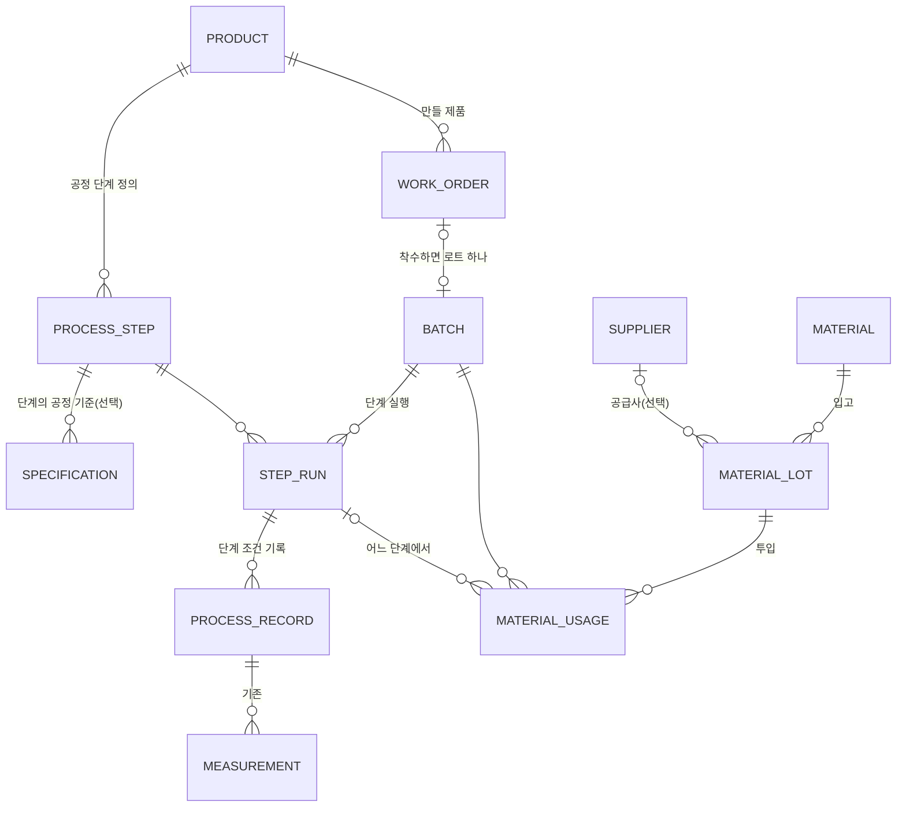

# MES 확장 설계 및 구현 계획 (Phase 0)

- 상태: 승인됨 (v0.2, 2026-10-27 — Q53~Q58 추천 답대로 확정)
- 작성일: 2026-10-27
- 근거: 사용자 요청 "PharmaFlow Bio — MES·LIMS·QMS 통합 운영관리 시스템 확장"(2026-10-27), `docs/PRD.md` v0.5, `docs/ERD.md` v0.11, `docs/IA.md` v2.5, `docs/personas/` v2, `docs/전환-영향분석-PharmaFlow-Bio.md`(D1~D14), `supabase/migrations/0001~0024`, `src/`
- 이 문서는 설계만 담는다. 코드·DB는 바꾸지 않았다. 기능마다 승인 후 spec → plan → qa 순서로 따로 만든다(하네스 2절).

> 표시: 🟢 새로 만듦, 🟡 기존 것을 넓힘, ⚪ 그대로 씀. `[가정]`은 사용자 확인 전 임시 판단이다(11절 질문).

---

## 0. 먼저 정할 것: 기능 번호

요청서는 새 기능을 "기능 009~015"로 불렀지만, **009는 이미 "슬랙 알림"(spec 009, 개발 끝)이다.** 번호가 겹치면 문서·커밋·출처 주석(`// FR-003 (spec 009)`)이 섞인다.

| 요청서 이름 | 제안 번호 | 폴더 |
|---|---|---|
| 기능 009 작업지시 | **010** | `docs/specs/010-작업지시/` |
| 기능 010 공정 단계 실행 | **011** | `011-공정단계-실행/` |
| 기능 011 원료 로트·투입 | **012** | `012-원료로트-투입/` |
| 기능 012 EBR 전자제조기록서 | **013** | `013-전자제조기록서/` |
| 기능 013 통합 대시보드 | **014** | `014-통합-현황/` |
| 기능 014·015 수율·설비 (선택) | **015·016** | `015-수율/`, `016-설비/` |

전에 후보로 둔 "Claude API 품질 브리핑"은 017 이후로 미룬다(API 키 없음). → **Q53**

---

## 1. 지금 기능을 LIMS·QMS·MES로 나누면

| 구분 | 지금 있는 것 | 근거 |
|---|---|---|
| **LIMS** (시험·검체) | 시험 규격·사내 관리기준·기준 버전, 시험값 입력과 세 단계 판정(정상·관리기준 이탈·규격 이탈), 판정 때 기준값 함께 저장, 재시험, 시험 대기 로트, 검체 인계(전달·인수·반납·소진) | spec 001·004·008, `specification`·`measurement`·`sample_transfer` |
| **QMS** (품질 보증) | 품질 이슈(규격·관리기준), 품질 영향 평가(승인·반려·보완 요청), 조치 요청·배정·완료, 이슈 종결 조건, 로트 보류, 내부 출하 검토, 승인 대기, 업무 이력(고치기·지우기 불가), 사용 기록, 슬랙·앱 알림, 허가정보·회수 공지 | spec 002·005·006·009, `quality_issue`·`deviation_review`·`action_request`·`work_history`·`notification` |
| **MES** (생산 실행) | 로트 등록, 공정 기록 한 번(생산량·설비 상태·공정 조건 값)과 공정 기준 판정, 공정 이탈 자동 보류, 생산 → QC·QA 검체 전달 | spec 001·004·008, `batch`·`process_record` |
| **MES에 없는 것** | 작업지시, 공정 단계·순서, 원료 로트·투입, 제조기록서 묶어 보기, 수율, 설비 | 이번 확장 범위 |

정리: LIMS·QMS는 "이탈 → 평가 → 조치 → 종결 → 출하 검토"까지 이어져 있고, MES는 **로트 등록과 공정 기록 한 줄**뿐이다. 그래서 확장은 MES 쪽을 채우고 이미 있는 LIMS·QMS 자료에 **연결**하는 일이다.

---

## 2. 생산 담당자의 지금 업무와 빈 곳

**지금 앱에서 하는 일** (`roles.js` 생산 담당자: `record_process`, `hold_batch`, `create_batch`, `request_action`)
1. 로트 등록 (로트번호 + 제품)
2. 공정 조건 입력 — 로트당 한 번에 모든 공정 항목을 넣는다. 어느 공정 단계의 값인지 없다
3. 로트 보류(사유), 조치 요청, 배정된 조치 결과 입력, 품질 영향 평가 작성
4. 검체 전달(생산 → QC 시험 검체, 생산 → QA 보존 검체), 반납 확인
5. 제조공정 홈: 생산 중 로트, 배정된 조치, 되돌아온 요청, 최근 공정 이탈

**빈 곳** (출처: 페르소나 v2, 요청서)
| # | 빈 곳 | 지금 생기는 일 | 채울 기능 |
|---|---|---|---|
| G1 | 무엇을 언제 얼마나 만들지(지시)가 없다 | 로트가 갑자기 생긴다. 계획 수량과 비교할 기준이 없다 | 010 작업지시 |
| G2 | 공정 순서·진행 위치가 없다 | 로트가 "생산 중" 하나로만 보인다. 이탈이 어느 단계에서 났는지 모른다. 평가 승인을 로트 해제로 알고 다음 공정을 진행하려 한 일 [문지아 8절] | 011 공정 단계 |
| G3 | 원료 로트를 추적할 수 없다 | "원료 확인" 조치를 해도 어느 원료 로트를 썼는지 근거가 없다. FR-39(공급사 반복 이탈)도 자료가 없다 | 012 원료 로트·투입 |
| G4 | 제조기록을 한 장으로 못 본다 | 시험은 QC 엑셀, 일탈은 QA 대장, 배치 기록은 종이 → 출하 서류 묶기에 로트당 3~4시간, 서명 누락 발견이 늦다 [오태민 8절] | 013 전자제조기록서 |
| G5 | 생산·시험·품질을 한눈에 못 본다 | 역할별 홈에 흩어져 있다 | 014 통합 현황 |
| G6 | 수율·설비 이력 없음 | 생산량만 숫자 하나 | 015·016 (선택) |

---

## 3. 새 기능별 기존 코드 재사용 계획

원칙: **새 표는 "지금 어디에도 없는 사실"만 저장한다.** 판정·보류·이슈·알림·이력은 지금 있는 함수·트리거를 그대로 탄다.

| 기능 | 그대로 씀 ⚪ | 넓힘 🟡 | 새로 만듦 🟢 |
|---|---|---|---|
| 010 작업지시 | `create_batch`의 로트번호 검사·로트 생성, `private.require_role`, 업무 이력 트리거, `modal.js`(저장 중 잠금·실패 시 입력 유지), `dom.js` 표·배지 | `batch` 에 작업지시 연결(작업지시 쪽 칸으로, 아래 5절), 제조공정 홈에 "작업지시" 칸, `roles.js` 버튼 표 | `work_order` 표, `create/release/start/cancel_work_order` 함수, `work-order-rules.js`(상태·버튼·수량 검사), 작업지시 목록 화면 |
| 011 공정 단계 | `record_process_conditions`의 판정·이슈·자동 보류 로직 전부, `private.judge`, `process_record`, `measurement`, `notify_out_of_spec`·`notify_issue` 트리거, `step-views.js`의 단계 표시줄 모양 | `record_process_conditions`에 선택 인자 `p_step_run_id` 하나, `process_record.step_run_id`(빈 값 허용), `specification.process_step_id`(빈 값 허용), 로트 상세 "공정 조건" 탭 → "공정 단계" 탭 | `process_step`(제품별 단계 정의), `step_run`(로트별 실행), `start_step`·`complete_step` 함수, `process-step-rules.js` |
| 012 원료 로트·투입 | ERD v0.7의 `supplier`·`material_lot` 설계(아직 안 만듦), 조치 종류 "원료 확인", 알림 틀 `add_notification` | ERD `batch_material` 설계 → `material_usage`로 바꿔 수량·단계를 담음, IA `SP_010201_MD 원료 로트 입고` → 원료 메뉴로 옮김 | `material`, `material_lot`, `material_usage` 표, `receive_material_lot`·`inspect_material_lot`·`use_material` 함수, `material-rules.js`(남은 양 계산·투입 가능 검사), 원료 로트 화면 |
| 013 EBR | 위 모든 표 읽기, `listMeasurements`·`listProcessRecords`·`listQualityIssues`·`listBatchHistory`, 검체 읽기(`store-samples.js`), 평가·조치 읽기, `formatDateTime`, 판정 글자(`judgement-rules.js`) | — | **표 없음.** `ebr-rules.js`(읽은 자료를 기록서 절로 묶고 빠진 항목 찾기, 순수 함수), `store-ebr.js`(읽기만), 기록서 화면·인쇄용 CSS |
| 014 통합 현황 | `dashboard-rules.js`(issueKpis·releaseWaiting·weekStart), `countBatchesByStatus`, `home-sections.js`의 kpiGrid·표 | IA `RG_010000_PG 품질 현황`(선택, 아직 안 만듦)을 통합 현황으로 넓힘 | `production-kpi-rules.js`(작업지시·단계·원료 집계, 순수 함수), 화면 1개 |
| 015 수율 (선택) | `work_order.planned_quantity`, `process_record.production_quantity` | — | 계산 함수만. 저장하지 않음 |
| 016 설비 (선택) | `process_record.equipment_status` | — | `equipment` 표와 단계 실행에 설비 고르기 (설계는 015 뒤에) |

**만들지 않는 것 (중복 금지)**
- 공정 판정을 새로 짜지 않는다 → `private.judge` 하나.
- 단계별 이탈용 새 이슈 표를 만들지 않는다 → `quality_issue` + `process_record_id`로 단계까지 따라간다.
- EBR 표·스냅샷을 만들지 않는다 → 매번 원본 표에서 읽는다.
- 작업지시 상세 페이지를 따로 만들지 않는다 → 착수 전에는 목록의 행·모달, 착수 뒤에는 로트 상세가 그 역할을 한다.
- 새 역할을 만들지 않는다(D4 유지). 원료 입고·검사도 지금 세 역할로 나눈다(6절).

---

## 4. 신규·변경 화면 목록

IA 화면 ID 규칙을 따른다. 🟢 신규, 🟡 변경.

| 화면 ID | 화면명 | 형태 | 주소 | 쓰는 역할 | 기능 |
|---|---|---|---|---|---|
| 🟢 WO_010000_PG | 작업지시 목록 | 페이지 | `#/work-orders` | 모두 읽기, 생산·QA 쓰기 | 010 |
| 🟢 WO_010100_MD | 작업지시 등록 | 모달 | | 생산 담당자·QA 관리자 | 010 |
| 🟢 WO_010101_MD | 작업지시 발행 | 모달 | | QA 관리자 `[가정 Q55]` | 010 |
| 🟢 WO_010102_MD | 작업 착수 (로트번호 입력 → 로트 생성) | 모달 | | 생산 담당자 | 010 |
| 🟢 WO_010103_MD | 작업지시 취소 (사유 필수) | 모달 | | 생산 담당자·QA 관리자 | 010 |
| 🟡 HM_030000_PG | 제조공정 홈 | 페이지 | `#/home/production` | 생산 | 010·011: "착수할 작업지시", "진행 중 공정 단계" 칸 추가 |
| 🟡 BT_010200_PG | 로트 상세 | 페이지 | `#/batches/:id` | 모두 | 010: 위쪽 요약에 작업지시 번호·계획 수량, 011: 현재 공정 단계 |
| 🟡 BT_010201_TB | 공정 조건 탭 → **공정 단계** 탭 | 탭 | `?tab=process` (주소 유지) | 모두 | 011: 단계 순서대로 상태·조건 기록·투입 원료. 단계 없는 예전 로트는 지금 모양 그대로 |
| 🟢 BT_010214_MD | 단계 착수 | 모달 | | 생산 | 011 |
| 🟡 BT_010205_MD | 공정 조건 입력 → **단계 완료** (그 단계 조건만) | 모달 | | 생산 | 011: 같은 모달을 단계에 묶어 재사용 |
| 🟢 BT_010215_MD | 원료 투입 | 모달 | | 생산 | 012: 단계 안에서 |
| 🟡 PD_010200_PG | 제품 상세 | 페이지 | `#/products/:id` | 모두 읽기 | 011: 공정 단계 정의 칸 |
| 🟢 PD_010203_MD | 공정 단계 등록·순서 | 모달 | | QA 관리자 | 011 |
| 🟡 PD_010201_MD | 기준 등록 | 모달 | | QA 관리자 | 011: 공정 기준에 "어느 단계" 고르기(선택) |
| 🟢 ML_010000_PG | 원료 로트 목록 | 페이지 | `#/materials` | 모두 읽기 | 012: 상태(격리·적합·부적합)·원료 거르기, 남은 양 |
| 🟢 ML_010100_MD | 원료 입고 (예전 SP_010201_MD) | 모달 | | 생산·QA `[가정 Q57]` | 012 |
| 🟢 ML_010101_MD | 입고 검사 판정 | 모달 | | QC 시험 담당자·QA 관리자 | 012 |
| 🟢 ML_010200_PG | 원료 로트 상세 (어느 제조 로트에 얼마 쓰였나) | 페이지 | `#/materials/:id` | 모두 읽기 | 012 |
| 🟢 BT_010213_PG | 전자제조기록서 | 페이지 | `#/batches/:id/ebr` | 모두 읽기 | 013: 인쇄 가능. 로트 상세 위쪽에 "제조기록서" 버튼 |
| 🟡 RG_010000_PG | 품질 현황 → **통합 현황** | 페이지 | `#/status` | 모두 읽기 | 014 `[가정 Q56]` |
| 🟡 옆 메뉴 | "작업지시", "원료", "통합 현황" 추가 | | | | `roles.js` 메뉴 표 |

화면 수가 늘어도 스택은 빌드 없는 JS 유지(2026-10-22 결정). 화면마다 파일 하나, 300줄 이하.

---

## 5. ERD 변경안

기존 표는 **지우거나 칸 이름을 바꾸지 않는다.** 칸 추가는 모두 "빈 값 허용"이라 예전 자료가 그대로 맞는다.



### 🟢 work_order — 작업지시 (010)
| 필드 | 타입 | 필수 | 설명 |
|---|---|---|---|
| id | uuid | 예 | |
| order_number | text, 유일 | 예 | 작업지시 번호 (예: WO-2610-001, 함수가 매김 `[가정]`) |
| product_id | uuid → product | 예 | |
| planned_quantity, unit | numeric > 0, text | 예 | 계획 수량·단위 (바이알·L) |
| planned_start, planned_end | date | 예 | 시작 ≤ 끝 |
| status | enum `draft` 작성, `released` 발행, `in_progress` 진행 중, `completed` 완료, `cancelled` 취소 | 예 | 6절 |
| batch_id | uuid → batch, 유일 | 착수 뒤 | 착수 때 로트를 만들어 연결 `[가정 Q54]` |
| note, cancel_reason | text ≤200 | 아니오 / 취소 때 | |
| created_by·created_at, released_by·released_at, started_by·started_at, completed_by·completed_at | uuid → profile, timestamptz | 단계마다 | 함수가 넣음 |

### 🟢 process_step — 제품별 공정 단계 정의 (011)
| 필드 | 타입 | 필수 | 설명 |
|---|---|---|---|
| id | uuid | 예 | |
| product_id | uuid → product | 예 | |
| step_order | integer 1~20 | 예 | (product_id, step_order) 유일 |
| name | text 1~40 | 예 | 예: 세포 배양, 정제, 원액 여과, 충전, 포장 (교육용 가상) |
| retired_at | timestamptz | 아니오 | 지우지 않고 "쓰지 않음" 표시. 실행 기록이 있는 단계는 바꾸지 않는다 |

### 🟢 step_run — 로트별 단계 실행 (011)
| 필드 | 타입 | 필수 | 설명 |
|---|---|---|---|
| id | uuid | 예 | |
| batch_id, process_step_id | uuid | 예 | (batch_id, process_step_id) 유일 — 단계는 로트당 한 번 |
| status | enum `in_progress`, `completed` | 예 | "대기"는 행이 없는 상태로 계산 |
| started_by·started_at, completed_by·completed_at | | 단계마다 | |

### 🟢 material / material_lot / material_usage (012)
| 표 | 필드 | 설명 |
|---|---|---|
| material | id, name(유일), unit, kind(`raw` 원료, `component` 자재) | 원료 마스터. 교육용 가상 (예: 항원 원액, 알루미늄 면역증강제, 주사용수, 바이알) |
| material_lot | id, material_id, supplier_id(빈 값 허용), lot_number, received_quantity > 0, received_at, expires_on, status(`quarantine` 격리, `released` 적합, `rejected` 부적합), inspected_by·at, reject_reason, received_by | (material_id, lot_number) 유일. ERD v0.7 `material_lot`의 `inspection_result`를 status로 넓힘 |
| material_usage | id, batch_id, step_run_id(빈 값 허용), material_lot_id, quantity > 0, used_by, used_at | 투입 기록. 고치거나 지우지 않음(잘못 넣었으면 수량 음수 줄 대신 **Q58**) |

**저장하지 않는 계산 값:** 원료 로트 남은 양(입고량 − 투입 합), 작업지시 진행률(완료 단계 수/전체), 수율(마지막 생산량/계획 수량), EBR 전체.

### 🟡 기존 표에 칸 추가 (빈 값 허용)
| 표 | 추가 칸 | 이유 |
|---|---|---|
| process_record | step_run_id uuid → step_run | 조건 기록이 어느 단계 것인지. 예전 기록은 빈 값 |
| specification | process_step_id uuid → process_step | 공정 기준이 어느 단계에서 재는지. 빈 값이면 지금처럼 "모든 단계 공통" |

`batch`에는 칸을 더하지 않는다(작업지시 → 로트 방향의 `work_order.batch_id`로 충분). ERD v0.7의 `batch_material`은 `material_usage`로 대신하고 ERD에서 고친다.

마이그레이션 번호: 0025(작업지시) → 0026(공정 단계) → 0027(원료). 각 마이그레이션은 지금처럼 되돌리는 시험 안에서 먼저 돌려 보고 적용한다. `replace_sample_data`(예시 되돌리기)에 새 표 지우기·예시 넣기를 더한다.

---

## 6. 역할별 권한·상태 전이

### 6-1. 권한 (쓰기는 지금처럼 `public` 함수로만, 함수 안에서 `private.require_role`)
| 할 일 | 생산 담당자 | QC 시험 담당자 | QA 관리자 | 열람자 |
|---|---|---|---|---|
| 작업지시 등록·취소(발행 전) | ✅ | | ✅ | |
| 작업지시 발행 | | | ✅ `[Q55]` | |
| 작업 착수(로트 생성) | ✅ | | ✅ | |
| 공정 단계 정의 | | | ✅ | |
| 단계 착수·완료(조건 입력) | ✅ | | ✅ | |
| 원료 입고 등록 | ✅ | | ✅ `[Q57]` | |
| 원료 입고 검사 판정 | | ✅ | ✅ | |
| 원료 투입 | ✅ | | ✅ | |
| 작업지시·단계·원료·EBR·통합 현황 읽기 | ✅ | ✅ | ✅ | ✅ |

QA 관리자가 모든 쓰기를 할 수 있는 것은 지금 규칙(`ALLOWED_ACTIONS.qa_manager`)과 같다.

### 6-2. 작업지시 상태
```
draft 작성 ──발행(QA)──▶ released 발행 ──착수(로트 생성)──▶ in_progress 진행 중 ──마지막 단계 완료──▶ completed 완료
   │                         │
   └──취소(사유)──▶ cancelled ◀──취소(사유, 착수 전만)
```
- 착수는 `released`에서만. 착수 때 로트번호를 받아 `create_batch` 규칙으로 로트를 만들고(`in_production`) 연결한다.
- 착수 뒤에는 취소하지 않는다. 그만둘 때는 지금처럼 **조치 "로트 폐기"**로 간다(로트가 `discarded`가 되면 작업지시도 `completed`로 닫고 사유를 이력에 `[가정]`).
- 완료는 사람이 누르지 않고 마지막 단계 완료 때 함수가 바꾼다.

### 6-3. 공정 단계 실행
```
(대기: 행 없음) ──착수──▶ in_progress ──완료(그 단계 공정 조건 입력·판정)──▶ completed
```
- **순서 강제:** 앞 단계가 `completed`여야 다음 단계를 착수할 수 있다.
- **로트 상태 확인:** 로트가 `in_production`일 때만 착수·완료. `on_hold`(규격 이탈 자동 보류·직접 보류)면 막고 "로트가 보류 중입니다. 품질 이슈를 처리한 뒤 진행해 주세요." → 평가 승인이 로트 해제가 아니라는 혼선[문지아]을 화면과 함수 양쪽에서 막는다.
- 단계 완료 = 그 단계 공정 기준만 받아 기존 `record_process_conditions` 로직으로 판정. 관리기준 이탈은 이슈만, 규격 이탈은 이슈 + 자동 보류(지금 규칙 그대로).
- 마지막 단계 완료 → 작업지시 `completed`. 로트 상태는 **바꾸지 않는다** — 지금처럼 첫 시험값이 `in_production → in_testing`으로 옮긴다 `[가정 Q55-b]`.
- 단계 정의가 없는 제품·예전 로트는 지금처럼 "공정 조건 입력" 한 번으로 쓴다(뒤로 호환).

### 6-4. 원료 로트
```
quarantine 격리 ──검사 적합──▶ released 적합 (투입 가능)
        └────검사 부적합(사유)──▶ rejected 부적합 (투입 불가)
```
- 투입 조건: `released`, 유효기한 지나지 않음, 남은 양 ≥ 투입량, 로트 `in_production`, (단계를 고르면) 그 단계 `in_progress`. 남은 양은 함수 안에서 원료 로트 행을 잠그고(`for update`) 계산해 동시에 두 사람이 넣어도 넘치지 않게 한다.
- 부적합 원료가 이미 쓰인 경우는 없다(검사 전 투입 불가). 적합 판정 뒤 문제가 드러나면 기존 조치 "원료 확인"으로 다룬다.

### 6-5. 알림 (spec 009 틀 재사용, 트리거만 추가)
| 일 | 받는 사람 |
|---|---|
| 작업지시 발행 | 생산 담당자 |
| 원료 입고 등록 | QC 시험 담당자 (검사 필요) |
| 원료 부적합 판정 | 생산 담당자·QA 관리자 |
| 마지막 단계 완료(작업지시 완료) | QA 관리자·QC 시험 담당자 (시험·기록서 검토 시작) |

알림 종류를 넓히는 일이라 기능마다 spec에서 확정한다.

---

## 7. EBR과 검체·시험·품질 자료 연결

**EBR은 새로 저장하지 않는다.** 로트 하나를 열쇠로 아래 표를 읽어 절마다 묶는다. 같은 정보를 두 곳에 두지 않으므로 기록서와 원본이 어긋날 수 없다.

| 기록서 절 | 읽는 표 (연결 칸) | 이미 있음? |
|---|---|---|
| 1. 로트·제품·작업지시 | `batch`, `product`, `work_order`(batch_id) | 작업지시만 새로 |
| 2. 공정 단계별 기록 | `step_run`(batch_id) → `process_record`(step_run_id) → `measurement`(process_record_id), 적용 기준·버전은 `measurement.applied_*` | 단계 연결만 새로 |
| 3. 원료 투입 | `material_usage`(batch_id, step_run_id) → `material_lot` → `material`·`supplier` | 새로 |
| 4. 검체 인계 | `sample_transfer`(batch_id) | ✅ spec 008 |
| 5. 시험 결과 | `measurement`(batch_id, specification.category = test), 재시험은 `action_request_id` | ✅ spec 001·004 |
| 6. 품질 이슈·평가·조치 | `quality_issue`(batch_id) → `deviation_review`, `action_request` | ✅ spec 002·005 |
| 7. 보류·내부 출하 검토 | `batch.status`·`hold_reason`, 결정 기록은 `work_history` | ✅ |
| 8. 업무 이력 전체 | `work_history`(batch_id) — 누가·언제·무엇 | ✅ |

- **"빠진 항목" 검사** (`ebr-rules.js`, 순수 함수): 착수 안 한 단계, 완료 안 한 단계, 조건 기록 없는 완료 단계, 시험 안 한 시험 항목, 인수 확인 안 된 검체, 열린 이슈, 승인 안 된 평가. 화면 맨 위에 "빠진 항목 N개"와 목록 → 출하 서류 묶기 전에 누락을 먼저 본다[오태민 "서명 누락을 전날 발견"].
- **"누가 했는가"**는 각 행의 `*_by`와 업무 이력으로 보여 준다. 전자서명이 아니라는 문구를 기록서 위에 둔다("교육용 기록 묶음입니다. 전자서명·21 CFR Part 11 기록이 아닙니다." — 하지 않을 것 유지).
- 읽기 권한은 지금 RLS(로그인한 모든 역할 읽기) 그대로. 새 표도 같은 읽기 정책.
- 출하 검토와의 관계: 기록서의 "빠진 항목"은 **보여 주기만** 하고 지금 `decide_release` 규칙(열린 이슈·미완료 시험)을 바꾸지 않는다. 막는 조건에 넣을지는 013 spec에서 묻는다.

---

## 8. 개발 우선순위

| 순서 | 기능 | 왜 이 순서 | 규모 어림 |
|---|---|---|---|
| 1 | **010 작업지시** | 다른 모든 MES 자료의 시작점. 기존 로트 생성과 맞물리는 부분이라 먼저 안정시켜야 한다 | 마이그레이션 1, 화면 1 + 모달 4, 시험 |
| 2 | **011 공정 단계** | 가장 큰 변경(기존 함수에 인자 추가). 원료 투입이 단계에 붙으므로 012보다 먼저 | 마이그레이션 1, 탭 변경, 모달 2 |
| 3 | **012 원료 로트·투입** | 단계가 있어야 "어느 단계에 무엇을" 기록 가능 | 마이그레이션 1, 화면 2 + 모달 3 |
| 4 | **013 EBR** | 1~3의 자료가 모여야 의미가 있다. DB 변경 없음 | 화면 1, 순수 함수 |
| 5 | **014 통합 현황** | 모든 숫자를 실제 자료에서 계산해야 하므로 마지막 | 화면 1, 순수 함수 |
| 6 | 015 수율 → 016 설비 | 선택. 시간이 남으면 | |

기능마다: spec 승인 → plan 승인 → qa.md → 단계별 개발·QA → 사람 QA → 브랜치 `phase-N-…` → PR → 병합(단계마다 승인, CLAUDE.md 전역과 다른 점).

---

## 9. 기능별 테스트 시나리오

종류: **함수** = `node --test "tests/*.test.js"`, **DB** = `supabase/tests/0NN_rules.sql`(되돌리는 시험, "PF_TEST 통과 N/N"), **화면** = 미리보기 브라우저에서 직접 조작 + 스크린샷. 화면에서 직접 확인하지 못한 것은 "확인 못 함"으로 적는다.

| 기능 | 시나리오 | 종류 |
|---|---|---|
| 010 | 계획 수량 0·음수·빈 값, 끝 날짜가 시작보다 앞 → 거절과 한국어 문구 | 함수·DB |
| 010 | QC 시험 담당자·열람자가 등록·발행·착수 → 권한 오류 | DB |
| 010 | draft에서 착수 → 거절 / released에서 착수 → 로트 `in_production` 생성·연결, 업무 이력 2줄 | DB |
| 010 | 이미 있는 로트번호로 착수 → 기존 문구로 거절, 작업지시는 released 그대로 | DB |
| 010 | 착수 뒤 취소 → 거절. 발행 전 취소 사유 없음 → 거절 | DB |
| 010 | 생산 담당자로 등록 → QA로 발행 → 생산으로 착수 → 로트 상세에 작업지시 번호 | 화면 |
| 011 | 1단계 완료 전 2단계 착수 → 거절 | DB |
| 011 | 단계 완료에서 규격 이탈 → 이슈 1개·자동 보류·QA 알림, 다음 단계 착수 거절("보류 중") | DB·화면 |
| 011 | 평가 승인 뒤에도 보류 로트면 단계 진행 불가 (승인 ≠ 해제) | DB |
| 011 | 단계 정의 없는 예전 로트 → 지금 공정 조건 입력이 그대로 동작(회귀) | DB·화면 |
| 011 | 기존 `record_process_conditions` 호출(단계 인자 없음) 결과가 바뀌지 않음 — 기존 001·004 DB 시험 전체 재실행 | DB 회귀 |
| 011 | 마지막 단계 완료 → 작업지시 completed, 로트 상태는 그대로 | DB |
| 012 | 격리·부적합·유효기한 지난 원료 투입 → 거절 | 함수·DB |
| 012 | 남은 양보다 많이 투입 → 거절, 남은 양 계산(입고 − 투입 합) | 함수·DB |
| 012 | 같은 원료 로트를 두 세션이 동시에 투입해 합이 입고량을 넘지 않음 (`for update`) | DB |
| 012 | QC가 입고 검사 적합 → 생산이 단계 안에서 투입 → 원료 로트 상세에 제조 로트 표시 | 화면 |
| 013 | 자료 없는 절은 "기록 없음", 빠진 항목 목록이 정확 (단계 미완료, 검체 인수 대기, 열린 이슈) | 함수 |
| 013 | 기록서 숫자·사람·시각이 원본 탭과 같다 (VX 예시 로트 하나로 대조) | 화면 |
| 013 | 인쇄 미리보기에서 표가 잘리지 않음, 휴대폰 폭 가로 스크롤 없음 | 화면 |
| 014 | 모든 숫자가 읽은 행에서 계산 — 자료를 하나 더 넣으면 숫자가 바뀐다, 자료 0이면 0과 빈 상태 문구 | 함수·화면 |
| 공통 | 사람 입력(작업지시 메모·단계 이름·원료명)은 `textContent`로만 그린다 | 코드 점검 |
| 공통 | 기존 시험 120개 + DB 시험 001~009 전부 통과(회귀) | 함수·DB |

---

## 10. 예상 충돌·위험

| # | 위험 | 영향 | 대응 |
|---|---|---|---|
| R1 | **기능 번호 충돌** (요청서 009 = 기존 슬랙 009) | 문서·주석 혼선 | 0절대로 010부터 (Q53) |
| R2 | `record_process_conditions`에 인자를 더하면 Postgres가 **같은 이름 함수를 두 개** 만들 수 있다 | 화면 호출이 "어느 함수인지 모름" 오류 | 한 마이그레이션 안에서 옛 함수를 지우고 기본값 있는 인자로 다시 만든다. 화면은 이름 붙인 인자로 부르므로 그대로 동작. 001·004 DB 시험 재실행 |
| R3 | 로트 생성 길이 두 개(작업지시 착수, 기존 "로트 등록") | 작업지시 없는 로트가 계속 생김 | 기존 로트 등록은 **남긴다**(삭제 금지). 010 spec에서 "새 로트는 작업지시로만"으로 바꿀지 묻는다(Q54) |
| R4 | 공정 기준이 단계 없이 등록된 예전 제품 | 단계 완료 때 어떤 항목을 받을지 모름 | `process_step_id`가 빈 기준은 "공통"으로 마지막 단계에서 받는다 `[가정]`. 가상 백신 A·B 예시는 단계별로 다시 넣는다 |
| R5 | 예시 자료 되돌리기(`replace_sample_data`)가 새 표를 모르면 **외래 키 오류**로 되돌리기 실패 | 시연 전 되돌리기 불가 (spec 008 때 겪음) | 마이그레이션마다 되돌리기 함수에 새 표 지우기 추가, DB 시험에 "되돌리기 성공" 사례 |
| R6 | 동시 투입으로 원료 재고가 음수 | 기록 신뢰 깨짐 | 함수 안 행 잠금 + 시험(9절) |
| R7 | EBR을 "공식 제조기록서"로 오해 | 규정 준수 범위 밖(하지 않을 것) | 화면 위 안내 문구, 전자서명·승인 버튼 없음 |
| R8 | 화면·메뉴가 늘어 옆 메뉴가 길어짐, 생산 담당자 홈 칸 증가 | 찾기 어려움 | 메뉴는 역할별로 필요한 것만(`roles.js`), 홈 칸은 "내가 할 일" 위주 |
| R9 | 파일 크기 규칙(300줄) — `batch-detail.js` 177줄, `app.js` 179줄에 탭·주소가 더해짐 | 규칙 위반 | 공정 단계 탭은 새 파일(`process-steps.js`), 주소는 표 한 줄씩 |
| R10 | 슬랙 알림 종류 확대 시 `notification.kind` 검사 제약을 다시 써야 함 (0024처럼) | 마이그레이션 실수로 알림 전체 실패 | 0024 방식(제약 지우고 다시) + 009 DB 시험 재실행 |
| R11 | Supabase 무료 플랜 한도 | 표 3~6개 추가, 행 수 적음 → 영향 작음 | 예시 자료는 로트 몇 개 분량만 |
| R12 | 지금 데모 DB에 시험용 로트(IFV-2610-005, TDP-2610-002)가 남아 있음 | 현황 숫자가 예시와 다름 | 되돌리기는 **사용자 승인 후에만**. 이번 설계에서는 DB를 건드리지 않음 |

---

## 11. 결정된 질문 (2026-10-27 사용자: "추천 답대로")

| # | 질문 | 결정 | 반영할 곳 |
|---|---|---|---|
| Q53 | 새 기능 번호를 010~016으로 바꿔도 되나? | 예. 009는 슬랙 알림으로 유지 | 모든 spec 폴더 이름 |
| Q54 | 작업지시와 로트는 1:1이고, **착수할 때 로트를 만든다**. 기존 "로트 등록" 버튼은 남기나? | 1:1, 착수 때 생성. 기존 버튼은 남기되 QA 관리자만(예외용) | 010 spec, ERD work_order.batch_id |
| Q55 | 작업지시 **발행은 QA 관리자만** 하고, 마지막 공정 완료는 로트 상태를 바꾸지 않는다(첫 시험값이 "시험 중"으로)? | 예. 발행은 QA 관리자만(생산이 쓰고 QA가 확인하는 두 사람 흐름), 로트 상태는 그대로 | 6절 권한·상태 |
| Q56 | 통합 대시보드는 새 화면 대신 **IA의 "품질 현황"(RG_010000_PG, 아직 안 만듦)을 넓혀** 만든다? | 예. 중복 화면 금지 원칙에 맞음 | 014 |
| Q57 | 원료 입고 등록은 누가? (창고 역할 없음, D4) | 생산 담당자·QA 관리자 등록, QC 검사 판정 | 012 권한 |
| Q58 | 잘못 넣은 원료 투입은 어떻게 바로잡나? | 고치기·지우기 없이 "투입 취소" 기록(같은 수량, 사유 필수)을 한 줄 더 남긴다 | 012 ERD |

결정에 따라 010 작업지시 spec부터 쓴다. 본문의 `[가정 Q5x]` 표시는 위 결정으로 확정된 것으로 읽는다.

---

## 12. 변경 기록
| 날짜 | 버전 | 바뀐 내용 |
|---|---|---|
| 2026-10-27 | v0.1 | Phase 0 설계 초안. 코드·DB 변경 없음 |
| 2026-10-27 | v0.2 | 사용자 승인. Q53~Q58 추천 답으로 확정 |
