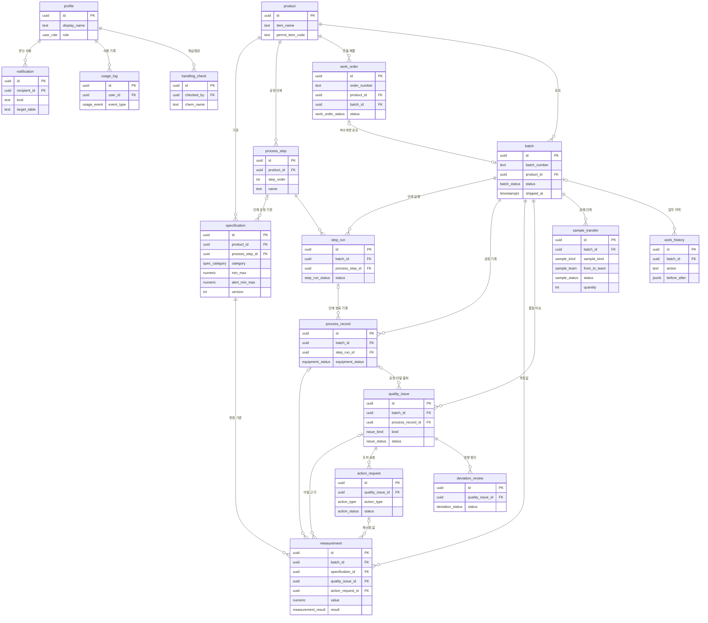

# 데이터 구조도

- 기준: 실제 Supabase 프로젝트 `pharmaflow`의 `public` 스키마 (2026-10-28 조회, 마이그레이션 0001~0034 적용 상태)
- 함께 볼 문서: [ERD.md](ERD.md) v0.17 — 칸마다 뜻과 출처, 상태 규칙, 권한은 ERD에 있다. 이 문서는 한눈에 보는 그림이다
- 표 17개, 다른 표를 가리키는 칸(외래키) 51개 — 업무 표끼리 21개, 사용자(profile)로 29개, profile → 로그인 표(`auth.users`) 1개

## 그림
GitHub에서 열면 아래 그림이 그려진다. 표마다 핵심 칸만 넣었다(기본 열쇠 PK, 다른 표를 가리키는 칸 FK, 상태 칸).

그림에서 `min_max`, `alert_min_max`, `from_to_team`, `before_after`는 실제로는 두 칸(`min_value`·`max_value`, `alert_min_value`·`alert_max_value`, `from_team`·`to_team`, `before_data`·`after_data`)을 한 줄로 줄여 적은 것이다.

## 묶음별 표
| 묶음 | 표 (화면 이름) | 칸 수 | 하는 일 |
|---|---|---|---|
| 기준정보 | product (제품) | 6 | 품목명, 허가정보 품목기준코드 |
| 기준정보 | specification (기준) | 11 | 시험 규격·사내 관리기준·버전, 공정 단계에 딸린 공정 기준 |
| 기준정보 | process_step (공정 단계) | 7 | 제품별 공정 순서 |
| 생산 | work_order (작업지시) | 21 | 작성·발행·착수·취소·완료, 착수하면 로트 하나 |
| 생산 | batch (로트) | 11 | 로트번호·상태(생산 중~출하 완료), 출하 완료 기록 |
| 생산 | step_run (단계 실행) | 10 | 로트의 공정 단계 착수·완료, 라인 클리어런스 |
| 생산 | process_record (공정 기록) | 7 | 생산량·설비 상태, 단계 완료 때 기록 |
| 품질 | measurement (측정값) | 15 | 시험값·공정값, 판정, 그때 적용한 기준·버전 |
| 품질 | quality_issue (품질 이슈) | 9 | 규격 이탈·관리기준 이탈, 처리 중·종결 |
| 품질 | action_request (조치 요청) | 13 | 재시험 등 조치, 승인·반려·완료 |
| 품질 | deviation_review (품질 영향 평가) | 13 | 이슈마다 하나, 검토 요청·승인·보완 요청 |
| 검체 | sample_transfer (검체 인계) | 25 | 생산→QC·QA, QA→QC, 인수·반납·소진·폐기, 보관 기한 |
| 기록·알림 | work_history (업무 이력) | 12 | 누가·언제·무엇을, 고치기·지우기 불가 |
| 기록·알림 | notification (알림) | 16 | 슬랙 개인 메시지·알림 함, 확인 표시 |
| 기록·알림 | usage_log (사용 기록) | 9 | 화면 열기·검색·공공데이터 호출 |
| 기록·알림 | handling_check (취급점검 기록) | 8 | MSDS 물질 취급점검 |
| 사람 | profile (사용자) | 5 | 이름·역할, Supabase 로그인 표(`auth.users`)와 1:1 |

## 그림에서 줄인 연결: "누가" 칸 → profile
선이 엉키지 않게 그림에는 알림·사용 기록·취급점검만 그렸다. 실제로는 아래 칸들이 모두 profile(사용자)을 가리킨다.

| 표 | profile을 가리키는 칸 |
|---|---|
| action_request | requested_by, assignee_id, reviewed_by |
| batch | created_by, shipped_by |
| deviation_review | requested_by, reviewed_by |
| handling_check | checked_by |
| measurement | measured_by |
| notification | recipient_id, created_by |
| process_record | recorded_by |
| process_step | created_by |
| quality_issue | closed_by |
| sample_transfer | sent_by, received_by, return_requested_by, return_confirmed_by, consumed_by, disposed_by |
| step_run | started_by, completed_by |
| usage_log | user_id |
| work_history | actor_id |
| work_order | created_by, released_by, started_by, cancelled_by, completed_by |

## ERD와 다른 점
- ERD v0.17에는 있지만 DB에 없는 표 4개: supplier(공급사), material_lot(원료 로트), batch_material(로트에 쓴 원료), supplier_review_request(공급사 품질 검토 요청). 선택 기능(PRD FR-39, Could)이라 아직 만들지 않았다.
- notification은 `target_table`·`target_id` 글자로 어느 기록에서 나온 알림인지 남긴다(외래키 아님). work_history도 `target_table`·`target_id`로 같은 방식.

## 변경 기록
| 날짜 | 바뀐 내용 |
|---|---|
| 2026-10-28 | 처음 작성 (실제 DB 0034 적용 상태, ERD v0.17과 대조) |
